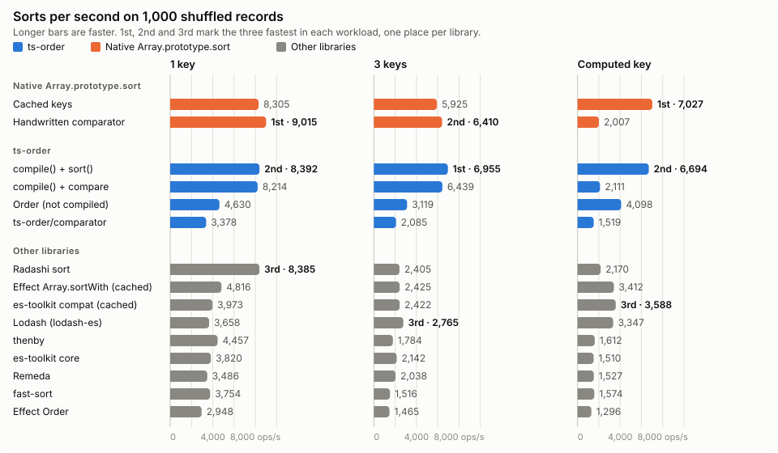
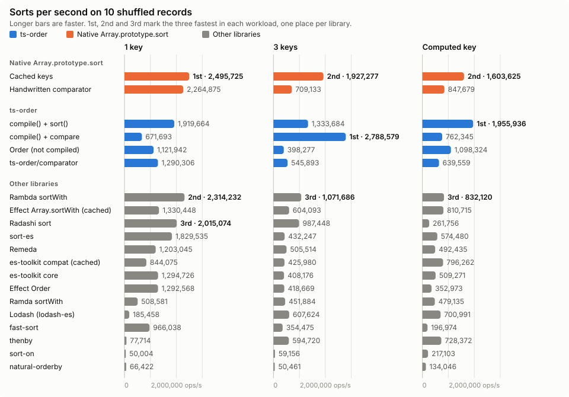
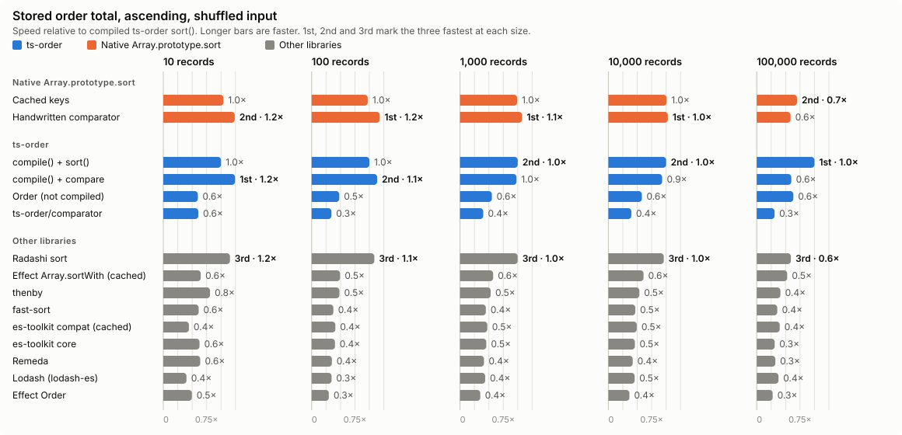
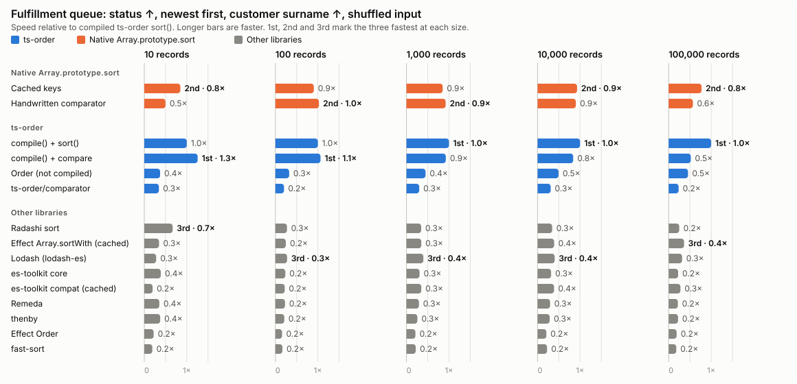

# Sorting benchmarks

## Summary

Sorts per second on **1,000 shuffled records**, a typical list or table. Higher is faster. **(2.0×)** means twice as many sorts per second as compiled ts-order `sort()`. 🥇🥈🥉 mark the three fastest in each column. Each library, and native code, wins at most one medal, with its fastest entry.



| | 1 key | 3 keys | Computed key |
| --- | ---: | ---: | ---: |
| **Native `Array.prototype.sort`** |  |  |  |
| Cached keys | 🥇 8,433 ops/s (1.3×) | 🥈 5,532 ops/s (1.7×) | 🥇 5,840 ops/s (2.1×) |
| Handwritten comparator | 8,304 ops/s (1.2×) | 5,133 ops/s (1.6×) | 113 ops/s (0.0×)† |
| **ts-order** |  |  |  |
| `compile()` + `sort()` | 🥈 6,716 ops/s (1.0×) | 3,233 ops/s (1.0×)† | 2,751 ops/s (1.0×)† |
| `compile()` + `compare` | 6,399 ops/s (1.0×) | 🥇 6,226 ops/s (1.9×) | 315 ops/s (0.1×)† |
| `Order` (not compiled) | 4,407 ops/s (0.7×) | 1,624 ops/s (0.5×)† | 🥈 3,415 ops/s (1.2×) |
| `ts-order/comparator` | 2,857 ops/s (0.4×) | 1,630 ops/s (0.5×)† | 917 ops/s (0.3×)† |
| **Other libraries** |  |  |  |
| Radashi sort | 🥉 6,387 ops/s (1.0×) | 2,037 ops/s (0.6×) | 2,019 ops/s (0.7×) |
| Lodash (lodash-es) | 3,536 ops/s (0.5×) | 2,474 ops/s (0.8×) | 2,816 ops/s (1.0×) |
| Effect Array.sortWith (cached) | 3,597 ops/s (0.5×)† | 2,196 ops/s (0.7×) | 🥉 2,864 ops/s (1.0×) |
| Rambda sortWith | 5,139 ops/s (0.8×) | 🥉 2,493 ops/s (0.8×) | 1,626 ops/s (0.6×) |
| thenby | 4,285 ops/s (0.6×) | 1,865 ops/s (0.6×) | 1,547 ops/s (0.6×) |
| sort-es | 3,937 ops/s (0.6×) | 1,782 ops/s (0.6×) | 1,367 ops/s (0.5×) |
| Remeda | 3,352 ops/s (0.5×) | 2,001 ops/s (0.6×) | 1,401 ops/s (0.5×) |
| es-toolkit core | 3,658 ops/s (0.5×) | 1,838 ops/s (0.6×) | 1,067 ops/s (0.4×) |
| Effect Order | 2,803 ops/s (0.4×) | 1,411 ops/s (0.4×) | 1,042 ops/s (0.4×) |
| fast-sort | 1,954 ops/s (0.3×)† | 1,469 ops/s (0.5×) | 1,339 ops/s (0.5×) |
| es-toolkit compat (cached) | 3,745 ops/s (0.6×) | 2,311 ops/s (0.7×) | 377 ops/s (0.1×)† |
| Ramda sortWith | 1,753 ops/s (0.3×) | 810 ops/s (0.3×)† | 1,061 ops/s (0.4×) |
| natural-orderby | 1,253 ops/s (0.2×) | 498 ops/s (0.2×) | 377 ops/s (0.1×)† |
| sort-on | 180 ops/s (0.0×)† | 150 ops/s (0.0×) | 513 ops/s (0.2×) |

- **1 key:** stored order total, ascending.
- **3 keys:** fulfillment queue: status ↑, newest first, customer surname ↑.
- **Computed key:** computed line-item total after discounts, descending.
- **†:** more than 20% variation between rounds. Treat close results in that cell with caution.

<details>
<summary>10 records</summary>



| | 1 key | 3 keys | Computed key |
| --- | ---: | ---: | ---: |
| **Native `Array.prototype.sort`** |  |  |  |
| Cached keys | 🥇 2,495,725 ops/s (1.3×) | 🥈 1,927,277 ops/s (1.4×) | 🥈 1,603,625 ops/s (0.8×) |
| Handwritten comparator | 2,264,875 ops/s (1.2×)† | 709,133 ops/s (0.5×)† | 847,679 ops/s (0.4×) |
| **ts-order** |  |  |  |
| `compile()` + `sort()` | 1,919,664 ops/s (1.0×) | 1,333,684 ops/s (1.0×)† | 🥇 1,955,936 ops/s (1.0×) |
| `compile()` + `compare` | 671,693 ops/s (0.3×)† | 🥇 2,788,579 ops/s (2.1×) | 762,345 ops/s (0.4×) |
| `Order` (not compiled) | 1,121,942 ops/s (0.6×) | 398,277 ops/s (0.3×)† | 1,098,324 ops/s (0.6×) |
| `ts-order/comparator` | 1,290,306 ops/s (0.7×)† | 545,893 ops/s (0.4×)† | 639,559 ops/s (0.3×) |
| **Other libraries** |  |  |  |
| Rambda sortWith | 🥈 2,314,232 ops/s (1.2×)† | 🥉 1,071,686 ops/s (0.8×) | 🥉 832,120 ops/s (0.4×) |
| Effect Array.sortWith (cached) | 1,330,448 ops/s (0.7×) | 604,093 ops/s (0.5×)† | 810,715 ops/s (0.4×) |
| Radashi sort | 🥉 2,015,074 ops/s (1.0×) | 987,448 ops/s (0.7×) | 261,756 ops/s (0.1×)† |
| sort-es | 1,829,535 ops/s (1.0×)† | 432,247 ops/s (0.3×)† | 574,480 ops/s (0.3×) |
| Remeda | 1,203,045 ops/s (0.6×) | 505,514 ops/s (0.4×)† | 492,435 ops/s (0.3×)† |
| es-toolkit compat (cached) | 844,075 ops/s (0.4×) | 425,980 ops/s (0.3×) | 796,262 ops/s (0.4×) |
| es-toolkit core | 1,294,726 ops/s (0.7×) | 408,176 ops/s (0.3×)† | 509,271 ops/s (0.3×)† |
| Effect Order | 1,292,568 ops/s (0.7×)† | 418,669 ops/s (0.3×) | 352,973 ops/s (0.2×) |
| Ramda sortWith | 508,581 ops/s (0.3×) | 451,884 ops/s (0.3×) | 479,135 ops/s (0.2×) |
| Lodash (lodash-es) | 185,458 ops/s (0.1×)† | 607,624 ops/s (0.5×) | 700,991 ops/s (0.4×) |
| fast-sort | 966,038 ops/s (0.5×) | 354,475 ops/s (0.3×) | 196,974 ops/s (0.1×)† |
| thenby | 77,714 ops/s (0.0×)† | 594,720 ops/s (0.4×) | 728,372 ops/s (0.4×) |
| sort-on | 50,004 ops/s (0.0×)† | 59,156 ops/s (0.0×) | 217,103 ops/s (0.1×) |
| natural-orderby | 66,422 ops/s (0.0×) | 50,461 ops/s (0.0×) | 134,046 ops/s (0.1×) |

</details>

<details>
<summary>100 records</summary>


| | 1 key | 3 keys | Computed key |
| --- | ---: | ---: | ---: |
| **Native `Array.prototype.sort`** |  |  |  |
| Cached keys | 153,186 ops/s (1.1×) | 142,232 ops/s (1.1×) | 🥈 125,685 ops/s (1.0×) |
| Handwritten comparator | 🥇 179,204 ops/s (1.3×) | 🥇 165,385 ops/s (1.3×) | 42,210 ops/s (0.3×) |
| **ts-order** |  |  |  |
| `compile()` + `sort()` | 138,097 ops/s (1.0×) | 125,494 ops/s (1.0×)† | 🥇 129,958 ops/s (1.0×) |
| `compile()` + `compare` | 🥈 150,124 ops/s (1.1×) | 🥈 162,138 ops/s (1.3×) | 7,424 ops/s (0.1×)† |
| `Order` (not compiled) | 71,228 ops/s (0.5×) | 51,663 ops/s (0.4×) | 62,840 ops/s (0.5×) |
| `ts-order/comparator` | 48,828 ops/s (0.4×) | 35,373 ops/s (0.3×) | 28,248 ops/s (0.2×) |
| **Other libraries** |  |  |  |
| Radashi sort | 🥉 133,231 ops/s (1.0×) | 43,148 ops/s (0.3×) | 39,283 ops/s (0.3×) |
| Rambda sortWith | 83,996 ops/s (0.6×) | 🥉 46,281 ops/s (0.4×) | 35,151 ops/s (0.3×) |
| Lodash (lodash-es) | 47,183 ops/s (0.3×) | 39,478 ops/s (0.3×) | 🥉 50,468 ops/s (0.4×) |
| es-toolkit compat (cached) | 60,986 ops/s (0.4×) | 33,271 ops/s (0.3×) | 44,484 ops/s (0.3×) |
| Effect Array.sortWith (cached) | 77,699 ops/s (0.6×) | 26,975 ops/s (0.2×)† | 42,834 ops/s (0.3×) |
| thenby | 73,964 ops/s (0.5×) | 33,616 ops/s (0.3×) | 31,641 ops/s (0.2×) |
| es-toolkit core | 59,489 ops/s (0.4×) | 36,753 ops/s (0.3×) | 29,780 ops/s (0.2×) |
| sort-es | 41,181 ops/s (0.3×) | 31,539 ops/s (0.3×) | 29,250 ops/s (0.2×) |
| Effect Order | 45,654 ops/s (0.3×) | 25,009 ops/s (0.2×) | 22,574 ops/s (0.2×) |
| Remeda | 32,492 ops/s (0.2×)† | 36,302 ops/s (0.3×) | 16,947 ops/s (0.1×)† |
| fast-sort | 58,024 ops/s (0.4×) | 15,621 ops/s (0.1×)† | 20,286 ops/s (0.2×)† |
| Ramda sortWith | 19,454 ops/s (0.1×)† | 21,183 ops/s (0.2×) | 19,904 ops/s (0.2×) |
| natural-orderby | 11,680 ops/s (0.1×)† | 3,699 ops/s (0.0×)† | 13,254 ops/s (0.1×) |
| sort-on | 3,290 ops/s (0.0×) | 2,213 ops/s (0.0×)† | 10,843 ops/s (0.1×) |

</details>

<details>
<summary>10,000 records</summary>


| | 1 key | 3 keys | Computed key |
| --- | ---: | ---: | ---: |
| **Native `Array.prototype.sort`** |  |  |  |
| Cached keys | 482 ops/s (1.0×) | 249 ops/s (0.6×)† | 🥈 332 ops/s (0.8×)† |
| Handwritten comparator | 🥇 586 ops/s (1.2×) | 🥈 363 ops/s (0.9×) | 120 ops/s (0.3×) |
| **ts-order** |  |  |  |
| `compile()` + `sort()` | 🥈 482 ops/s (1.0×) | 🥇 411 ops/s (1.0×) | 🥇 398 ops/s (1.0×) |
| `compile()` + `compare` | 239 ops/s (0.5×)† | 350 ops/s (0.8×) | 111 ops/s (0.3×) |
| `Order` (not compiled) | 306 ops/s (0.6×) | 197 ops/s (0.5×) | 265 ops/s (0.7×) |
| `ts-order/comparator` | 129 ops/s (0.3×)† | 122 ops/s (0.3×) | 88.7 ops/s (0.2×) |
| **Other libraries** |  |  |  |
| Effect Array.sortWith (cached) | 322 ops/s (0.7×) | 🥉 160 ops/s (0.4×) | 206 ops/s (0.5×) |
| es-toolkit compat (cached) | 277 ops/s (0.6×) | 153 ops/s (0.4×) | 🥉 217 ops/s (0.5×) |
| Radashi sort | 🥉 470 ops/s (1.0×) | 132 ops/s (0.3×) | 124 ops/s (0.3×) |
| Rambda sortWith | 361 ops/s (0.7×) | 155 ops/s (0.4×) | 87.1 ops/s (0.2×) |
| Lodash (lodash-es) | 172 ops/s (0.4×)† | 158 ops/s (0.4×) | 134 ops/s (0.3×)† |
| sort-es | 257 ops/s (0.5×) | 108 ops/s (0.3×) | 88.7 ops/s (0.2×) |
| es-toolkit core | 252 ops/s (0.5×) | 126 ops/s (0.3×) | 64.1 ops/s (0.2×)† |
| Remeda | 225 ops/s (0.5×) | 95.9 ops/s (0.2×) | 85 ops/s (0.2×) |
| Effect Order | 195 ops/s (0.4×) | 90 ops/s (0.2×) | 72 ops/s (0.2×) |
| fast-sort | 238 ops/s (0.5×) | 88.8 ops/s (0.2×) | 56 ops/s (0.1×)† |
| thenby | 153 ops/s (0.3×)† | 109 ops/s (0.3×) | 65.3 ops/s (0.2×)† |
| Ramda sortWith | 131 ops/s (0.3×) | 61.6 ops/s (0.1×) | 66.3 ops/s (0.2×) |
| natural-orderby | 49.5 ops/s (0.1×) | 34.8 ops/s (0.1×) | 77.7 ops/s (0.2×) |
| sort-on | 15.6 ops/s (0.0×) | 8.66 ops/s (0.0×) | 35.3 ops/s (0.1×) |

</details>

<details>
<summary>100,000 records</summary>


| | 1 key | 3 keys | Computed key |
| --- | ---: | ---: | ---: |
| **Native `Array.prototype.sort`** |  |  |  |
| Cached keys | 🥈 22.8 ops/s (0.7×)† | 🥈 16.1 ops/s (0.8×) | 🥈 12.8 ops/s (1.0×) |
| Handwritten comparator | 21 ops/s (0.7×) | 10.5 ops/s (0.5×) | 2.09 ops/s (0.2×)† |
| **ts-order** |  |  |  |
| `compile()` + `sort()` | 🥇 32.2 ops/s (1.0×) | 🥇 21 ops/s (1.0×) | 13.3 ops/s (1.0×) |
| `compile()` + `compare` | 12 ops/s (0.4×) | 6.22 ops/s (0.3×)† | 2.54 ops/s (0.2×) |
| `Order` (not compiled) | 22.6 ops/s (0.7×) | 10.3 ops/s (0.5×) | 🥇 13.3 ops/s (1.0×) |
| `ts-order/comparator` | 7.5 ops/s (0.2×) | 5.71 ops/s (0.3×) | 2.5 ops/s (0.2×) |
| **Other libraries** |  |  |  |
| Effect Array.sortWith (cached) | 🥉 18.1 ops/s (0.6×) | 🥉 6.51 ops/s (0.3×) | 🥉 9.2 ops/s (0.7×)† |
| Lodash (lodash-es) | 10.9 ops/s (0.3×) | 5.6 ops/s (0.3×) | 8.52 ops/s (0.6×) |
| es-toolkit compat (cached) | 10.2 ops/s (0.3×) | 6.37 ops/s (0.3×) | 7 ops/s (0.5×)† |
| Radashi sort | 16.6 ops/s (0.5×)† | 4.78 ops/s (0.2×) | 2.83 ops/s (0.2×) |
| Rambda sortWith | 10.6 ops/s (0.3×)† | 5.54 ops/s (0.3×) | 2.85 ops/s (0.2×) |
| thenby | 11.7 ops/s (0.4×) | 4.65 ops/s (0.2×) | 2.44 ops/s (0.2×) |
| sort-es | 12 ops/s (0.4×) | 5.02 ops/s (0.2×) | 2.15 ops/s (0.2×) |
| fast-sort | 13.1 ops/s (0.4×) | 3.63 ops/s (0.2×) | 2.6 ops/s (0.2×) |
| Remeda | 9 ops/s (0.3×) | 5.13 ops/s (0.2×) | 2.51 ops/s (0.2×) |
| Effect Order | 8.49 ops/s (0.3×) | 4.4 ops/s (0.2×) | 2.7 ops/s (0.2×) |
| es-toolkit core | 7.62 ops/s (0.2×)† | 5.6 ops/s (0.3×) | 1.85 ops/s (0.1×) |
| Ramda sortWith | 6.46 ops/s (0.2×) | 2.87 ops/s (0.1×) | 2.16 ops/s (0.2×) |
| natural-orderby | 4.33 ops/s (0.1×) | 1.72 ops/s (0.1×) | 3.8 ops/s (0.3×)† |
| sort-on | 1.12 ops/s (0.0×) | 0.479 ops/s (0.0×) | 0.98 ops/s (0.1×) |

</details>

[Interactive ranked charts](BENCHMARKS.html) · [Historical exhaustive run, before review fixes](benchmarks/full.md)

Measured sizes: **10, 100, 1,000, 10,000, 100,000** records · 2 rounds · shuffled input.

**Short profile:** lower sampling budgets. Use for iteration, not definitive performance claims.

## Runtime results

The code behind every row is listed under [Sorting code](#sorting-code).

Same format as the summary: sorts per second, then the speed relative to compiled ts-order `sort()`. 🥇🥈🥉 mark the three fastest in each column, one medal per library. Expand the variation table before you trust a close result.

### Stored order total, ascending

#### shuffled



| | 10 | 100 | 1,000 | 10,000 | 100,000 |
| --- | ---: | ---: | ---: | ---: | ---: |
| **Native `Array.prototype.sort`** |  |  |  |  |  |
| Cached keys | 🥇 2,495,725 ops/s (1.3×) | 153,186 ops/s (1.1×) | 🥇 8,433 ops/s (1.3×) | 482 ops/s (1.0×) | 🥈 22.8 ops/s (0.7×)† |
| Handwritten comparator | 2,264,875 ops/s (1.2×)† | 🥇 179,204 ops/s (1.3×) | 8,304 ops/s (1.2×) | 🥇 586 ops/s (1.2×) | 21 ops/s (0.7×) |
| **ts-order** |  |  |  |  |  |
| `compile()` + `sort()` | 1,919,664 ops/s (1.0×) | 138,097 ops/s (1.0×) | 🥈 6,716 ops/s (1.0×) | 🥈 482 ops/s (1.0×) | 🥇 32.2 ops/s (1.0×) |
| `compile()` + `compare` | 671,693 ops/s (0.3×)† | 🥈 150,124 ops/s (1.1×) | 6,399 ops/s (1.0×) | 239 ops/s (0.5×)† | 12 ops/s (0.4×) |
| `Order` (not compiled) | 1,121,942 ops/s (0.6×) | 71,228 ops/s (0.5×) | 4,407 ops/s (0.7×) | 306 ops/s (0.6×) | 22.6 ops/s (0.7×) |
| `ts-order/comparator` | 1,290,306 ops/s (0.7×)† | 48,828 ops/s (0.4×) | 2,857 ops/s (0.4×) | 129 ops/s (0.3×)† | 7.5 ops/s (0.2×) |
| **Other libraries** |  |  |  |  |  |
| Radashi sort | 🥉 2,015,074 ops/s (1.0×) | 🥉 133,231 ops/s (1.0×) | 🥉 6,387 ops/s (1.0×) | 🥉 470 ops/s (1.0×) | 16.6 ops/s (0.5×)† |
| Rambda sortWith | 🥈 2,314,232 ops/s (1.2×)† | 83,996 ops/s (0.6×) | 5,139 ops/s (0.8×) | 361 ops/s (0.7×) | 10.6 ops/s (0.3×)† |
| Effect Array.sortWith (cached) | 1,330,448 ops/s (0.7×) | 77,699 ops/s (0.6×) | 3,597 ops/s (0.5×)† | 322 ops/s (0.7×) | 🥉 18.1 ops/s (0.6×) |
| sort-es | 1,829,535 ops/s (1.0×)† | 41,181 ops/s (0.3×) | 3,937 ops/s (0.6×) | 257 ops/s (0.5×) | 12 ops/s (0.4×) |
| es-toolkit compat (cached) | 844,075 ops/s (0.4×) | 60,986 ops/s (0.4×) | 3,745 ops/s (0.6×) | 277 ops/s (0.6×) | 10.2 ops/s (0.3×) |
| es-toolkit core | 1,294,726 ops/s (0.7×) | 59,489 ops/s (0.4×) | 3,658 ops/s (0.5×) | 252 ops/s (0.5×) | 7.62 ops/s (0.2×)† |
| fast-sort | 966,038 ops/s (0.5×) | 58,024 ops/s (0.4×) | 1,954 ops/s (0.3×)† | 238 ops/s (0.5×) | 13.1 ops/s (0.4×) |
| Effect Order | 1,292,568 ops/s (0.7×)† | 45,654 ops/s (0.3×) | 2,803 ops/s (0.4×) | 195 ops/s (0.4×) | 8.49 ops/s (0.3×) |
| Remeda | 1,203,045 ops/s (0.6×) | 32,492 ops/s (0.2×)† | 3,352 ops/s (0.5×) | 225 ops/s (0.5×) | 9 ops/s (0.3×) |
| Lodash (lodash-es) | 185,458 ops/s (0.1×)† | 47,183 ops/s (0.3×) | 3,536 ops/s (0.5×) | 172 ops/s (0.4×)† | 10.9 ops/s (0.3×) |
| thenby | 77,714 ops/s (0.0×)† | 73,964 ops/s (0.5×) | 4,285 ops/s (0.6×) | 153 ops/s (0.3×)† | 11.7 ops/s (0.4×) |
| Ramda sortWith | 508,581 ops/s (0.3×) | 19,454 ops/s (0.1×)† | 1,753 ops/s (0.3×) | 131 ops/s (0.3×) | 6.46 ops/s (0.2×) |
| natural-orderby | 66,422 ops/s (0.0×) | 11,680 ops/s (0.1×)† | 1,253 ops/s (0.2×) | 49.5 ops/s (0.1×) | 4.33 ops/s (0.1×) |
| sort-on | 50,004 ops/s (0.0×)† | 3,290 ops/s (0.0×) | 180 ops/s (0.0×)† | 15.6 ops/s (0.0×) | 1.12 ops/s (0.0×) |

<details>
<summary>Round-to-round variation (not confidence intervals)</summary>

| Implementation | 10 | 100 | 1,000 | 10,000 | 100,000 |
| --- | ---: | ---: | ---: | ---: | ---: |
| **Native `Array.prototype.sort`** |  |  |  |  |  |
| Cached keys | ±10% | ±5% | ±1% | ±17% | ±21% |
| Handwritten comparator | ±33% | ±2% | ±5% | ±6% | ±7% |
| **ts-order** |  |  |  |  |  |
| `compile()` + `sort()` | ±4% | ±8% | ±16% | ±1% | ±10% |
| `compile()` + `compare` | ±76% | ±11% | ±19% | ±52% | ±6% |
| `Order` (not compiled) | ±13% | ±7% | ±3% | ±9% | ±3% |
| `ts-order/comparator` | ±32% | ±5% | ±11% | ±41% | ±9% |
| **Other libraries** |  |  |  |  |  |
| Radashi sort | ±15% | ±11% | ±19% | ±8% | ±22% |
| Rambda sortWith | ±20% | ±7% | ±2% | ±1% | ±31% |
| Effect Array.sortWith (cached) | ±11% | ±2% | ±24% | ±3% | ±5% |
| sort-es | ±20% | ±7% | ±1% | ±0% | ±1% |
| es-toolkit compat (cached) | ±9% | ±5% | ±5% | ±3% | ±13% |
| es-toolkit core | ±9% | ±8% | ±2% | ±3% | ±37% |
| fast-sort | ±13% | ±0% | ±46% | ±15% | ±1% |
| Effect Order | ±29% | ±2% | ±3% | ±1% | ±11% |
| Remeda | ±1% | ±39% | ±3% | ±5% | ±8% |
| Lodash (lodash-es) | ±73% | ±11% | ±2% | ±27% | ±5% |
| thenby | ±95% | ±5% | ±1% | ±46% | ±0% |
| Ramda sortWith | ±3% | ±35% | ±6% | ±2% | ±5% |
| natural-orderby | ±12% | ±25% | ±0% | ±17% | ±7% |
| sort-on | ±37% | ±17% | ±28% | ±2% | ±7% |

</details>

### Fulfillment queue: status ↑, newest first, customer surname ↑

#### shuffled



| | 10 | 100 | 1,000 | 10,000 | 100,000 |
| --- | ---: | ---: | ---: | ---: | ---: |
| **Native `Array.prototype.sort`** |  |  |  |  |  |
| Cached keys | 🥈 1,927,277 ops/s (1.4×) | 142,232 ops/s (1.1×) | 🥈 5,532 ops/s (1.7×) | 249 ops/s (0.6×)† | 🥈 16.1 ops/s (0.8×) |
| Handwritten comparator | 709,133 ops/s (0.5×)† | 🥇 165,385 ops/s (1.3×) | 5,133 ops/s (1.6×) | 🥈 363 ops/s (0.9×) | 10.5 ops/s (0.5×) |
| **ts-order** |  |  |  |  |  |
| `compile()` + `sort()` | 1,333,684 ops/s (1.0×)† | 125,494 ops/s (1.0×)† | 3,233 ops/s (1.0×)† | 🥇 411 ops/s (1.0×) | 🥇 21 ops/s (1.0×) |
| `compile()` + `compare` | 🥇 2,788,579 ops/s (2.1×) | 🥈 162,138 ops/s (1.3×) | 🥇 6,226 ops/s (1.9×) | 350 ops/s (0.8×) | 6.22 ops/s (0.3×)† |
| `Order` (not compiled) | 398,277 ops/s (0.3×)† | 51,663 ops/s (0.4×) | 1,624 ops/s (0.5×)† | 197 ops/s (0.5×) | 10.3 ops/s (0.5×) |
| `ts-order/comparator` | 545,893 ops/s (0.4×)† | 35,373 ops/s (0.3×) | 1,630 ops/s (0.5×)† | 122 ops/s (0.3×) | 5.71 ops/s (0.3×) |
| **Other libraries** |  |  |  |  |  |
| Rambda sortWith | 🥉 1,071,686 ops/s (0.8×) | 🥉 46,281 ops/s (0.4×) | 🥉 2,493 ops/s (0.8×) | 155 ops/s (0.4×) | 5.54 ops/s (0.3×) |
| Radashi sort | 987,448 ops/s (0.7×) | 43,148 ops/s (0.3×) | 2,037 ops/s (0.6×) | 132 ops/s (0.3×) | 4.78 ops/s (0.2×) |
| Lodash (lodash-es) | 607,624 ops/s (0.5×) | 39,478 ops/s (0.3×) | 2,474 ops/s (0.8×) | 158 ops/s (0.4×) | 5.6 ops/s (0.3×) |
| Effect Array.sortWith (cached) | 604,093 ops/s (0.5×)† | 26,975 ops/s (0.2×)† | 2,196 ops/s (0.7×) | 🥉 160 ops/s (0.4×) | 🥉 6.51 ops/s (0.3×) |
| es-toolkit compat (cached) | 425,980 ops/s (0.3×) | 33,271 ops/s (0.3×) | 2,311 ops/s (0.7×) | 153 ops/s (0.4×) | 6.37 ops/s (0.3×) |
| es-toolkit core | 408,176 ops/s (0.3×)† | 36,753 ops/s (0.3×) | 1,838 ops/s (0.6×) | 126 ops/s (0.3×) | 5.6 ops/s (0.3×) |
| thenby | 594,720 ops/s (0.4×) | 33,616 ops/s (0.3×) | 1,865 ops/s (0.6×) | 109 ops/s (0.3×) | 4.65 ops/s (0.2×) |
| Remeda | 505,514 ops/s (0.4×)† | 36,302 ops/s (0.3×) | 2,001 ops/s (0.6×) | 95.9 ops/s (0.2×) | 5.13 ops/s (0.2×) |
| sort-es | 432,247 ops/s (0.3×)† | 31,539 ops/s (0.3×) | 1,782 ops/s (0.6×) | 108 ops/s (0.3×) | 5.02 ops/s (0.2×) |
| Effect Order | 418,669 ops/s (0.3×) | 25,009 ops/s (0.2×) | 1,411 ops/s (0.4×) | 90 ops/s (0.2×) | 4.4 ops/s (0.2×) |
| fast-sort | 354,475 ops/s (0.3×) | 15,621 ops/s (0.1×)† | 1,469 ops/s (0.5×) | 88.8 ops/s (0.2×) | 3.63 ops/s (0.2×) |
| Ramda sortWith | 451,884 ops/s (0.3×) | 21,183 ops/s (0.2×) | 810 ops/s (0.3×)† | 61.6 ops/s (0.1×) | 2.87 ops/s (0.1×) |
| natural-orderby | 50,461 ops/s (0.0×) | 3,699 ops/s (0.0×)† | 498 ops/s (0.2×) | 34.8 ops/s (0.1×) | 1.72 ops/s (0.1×) |
| sort-on | 59,156 ops/s (0.0×) | 2,213 ops/s (0.0×)† | 150 ops/s (0.0×) | 8.66 ops/s (0.0×) | 0.479 ops/s (0.0×) |

<details>
<summary>Round-to-round variation (not confidence intervals)</summary>

| Implementation | 10 | 100 | 1,000 | 10,000 | 100,000 |
| --- | ---: | ---: | ---: | ---: | ---: |
| **Native `Array.prototype.sort`** |  |  |  |  |  |
| Cached keys | ±14% | ±3% | ±12% | ±30% | ±18% |
| Handwritten comparator | ±64% | ±2% | ±19% | ±3% | ±6% |
| **ts-order** |  |  |  |  |  |
| `compile()` + `sort()` | ±42% | ±22% | ±50% | ±0% | ±14% |
| `compile()` + `compare` | ±6% | ±2% | ±0% | ±0% | ±28% |
| `Order` (not compiled) | ±54% | ±1% | ±45% | ±1% | ±12% |
| `ts-order/comparator` | ±21% | ±0% | ±22% | ±5% | ±10% |
| **Other libraries** |  |  |  |  |  |
| Rambda sortWith | ±2% | ±6% | ±2% | ±7% | ±8% |
| Radashi sort | ±14% | ±3% | ±14% | ±3% | ±7% |
| Lodash (lodash-es) | ±0% | ±11% | ±5% | ±10% | ±4% |
| Effect Array.sortWith (cached) | ±27% | ±32% | ±8% | ±1% | ±5% |
| es-toolkit compat (cached) | ±5% | ±7% | ±1% | ±1% | ±8% |
| es-toolkit core | ±42% | ±6% | ±8% | ±3% | ±3% |
| thenby | ±14% | ±3% | ±2% | ±6% | ±12% |
| Remeda | ±33% | ±2% | ±2% | ±18% | ±4% |
| sort-es | ±39% | ±1% | ±2% | ±2% | ±10% |
| Effect Order | ±18% | ±1% | ±3% | ±1% | ±3% |
| fast-sort | ±11% | ±42% | ±2% | ±1% | ±3% |
| Ramda sortWith | ±7% | ±1% | ±31% | ±10% | ±18% |
| natural-orderby | ±1% | ±36% | ±1% | ±0% | ±2% |
| sort-on | ±3% | ±24% | ±3% | ±5% | ±12% |

</details>

### Computed line-item total after discounts, descending

#### shuffled


| | 10 | 100 | 1,000 | 10,000 | 100,000 |
| --- | ---: | ---: | ---: | ---: | ---: |
| **Native `Array.prototype.sort`** |  |  |  |  |  |
| Cached keys | 🥈 1,603,625 ops/s (0.8×) | 🥈 125,685 ops/s (1.0×) | 🥇 5,840 ops/s (2.1×) | 🥈 332 ops/s (0.8×)† | 🥈 12.8 ops/s (1.0×) |
| Handwritten comparator | 847,679 ops/s (0.4×) | 42,210 ops/s (0.3×) | 113 ops/s (0.0×)† | 120 ops/s (0.3×) | 2.09 ops/s (0.2×)† |
| **ts-order** |  |  |  |  |  |
| `compile()` + `sort()` | 🥇 1,955,936 ops/s (1.0×) | 🥇 129,958 ops/s (1.0×) | 2,751 ops/s (1.0×)† | 🥇 398 ops/s (1.0×) | 13.3 ops/s (1.0×) |
| `compile()` + `compare` | 762,345 ops/s (0.4×) | 7,424 ops/s (0.1×)† | 315 ops/s (0.1×)† | 111 ops/s (0.3×) | 2.54 ops/s (0.2×) |
| `Order` (not compiled) | 1,098,324 ops/s (0.6×) | 62,840 ops/s (0.5×) | 🥈 3,415 ops/s (1.2×) | 265 ops/s (0.7×) | 🥇 13.3 ops/s (1.0×) |
| `ts-order/comparator` | 639,559 ops/s (0.3×) | 28,248 ops/s (0.2×) | 917 ops/s (0.3×)† | 88.7 ops/s (0.2×) | 2.5 ops/s (0.2×) |
| **Other libraries** |  |  |  |  |  |
| Effect Array.sortWith (cached) | 810,715 ops/s (0.4×) | 42,834 ops/s (0.3×) | 🥉 2,864 ops/s (1.0×) | 206 ops/s (0.5×) | 🥉 9.2 ops/s (0.7×)† |
| Lodash (lodash-es) | 700,991 ops/s (0.4×) | 🥉 50,468 ops/s (0.4×) | 2,816 ops/s (1.0×) | 134 ops/s (0.3×)† | 8.52 ops/s (0.6×) |
| es-toolkit compat (cached) | 796,262 ops/s (0.4×) | 44,484 ops/s (0.3×) | 377 ops/s (0.1×)† | 🥉 217 ops/s (0.5×) | 7 ops/s (0.5×)† |
| Rambda sortWith | 🥉 832,120 ops/s (0.4×) | 35,151 ops/s (0.3×) | 1,626 ops/s (0.6×) | 87.1 ops/s (0.2×) | 2.85 ops/s (0.2×) |
| Radashi sort | 261,756 ops/s (0.1×)† | 39,283 ops/s (0.3×) | 2,019 ops/s (0.7×) | 124 ops/s (0.3×) | 2.83 ops/s (0.2×) |
| thenby | 728,372 ops/s (0.4×) | 31,641 ops/s (0.2×) | 1,547 ops/s (0.6×) | 65.3 ops/s (0.2×)† | 2.44 ops/s (0.2×) |
| sort-es | 574,480 ops/s (0.3×) | 29,250 ops/s (0.2×) | 1,367 ops/s (0.5×) | 88.7 ops/s (0.2×) | 2.15 ops/s (0.2×) |
| Remeda | 492,435 ops/s (0.3×)† | 16,947 ops/s (0.1×)† | 1,401 ops/s (0.5×) | 85 ops/s (0.2×) | 2.51 ops/s (0.2×) |
| es-toolkit core | 509,271 ops/s (0.3×)† | 29,780 ops/s (0.2×) | 1,067 ops/s (0.4×) | 64.1 ops/s (0.2×)† | 1.85 ops/s (0.1×) |
| Effect Order | 352,973 ops/s (0.2×) | 22,574 ops/s (0.2×) | 1,042 ops/s (0.4×) | 72 ops/s (0.2×) | 2.7 ops/s (0.2×) |
| Ramda sortWith | 479,135 ops/s (0.2×) | 19,904 ops/s (0.2×) | 1,061 ops/s (0.4×) | 66.3 ops/s (0.2×) | 2.16 ops/s (0.2×) |
| fast-sort | 196,974 ops/s (0.1×)† | 20,286 ops/s (0.2×)† | 1,339 ops/s (0.5×) | 56 ops/s (0.1×)† | 2.6 ops/s (0.2×) |
| natural-orderby | 134,046 ops/s (0.1×) | 13,254 ops/s (0.1×) | 377 ops/s (0.1×)† | 77.7 ops/s (0.2×) | 3.8 ops/s (0.3×)† |
| sort-on | 217,103 ops/s (0.1×) | 10,843 ops/s (0.1×) | 513 ops/s (0.2×) | 35.3 ops/s (0.1×) | 0.98 ops/s (0.1×) |

<details>
<summary>Round-to-round variation (not confidence intervals)</summary>

| Implementation | 10 | 100 | 1,000 | 10,000 | 100,000 |
| --- | ---: | ---: | ---: | ---: | ---: |
| **Native `Array.prototype.sort`** |  |  |  |  |  |
| Cached keys | ±5% | ±2% | ±5% | ±24% | ±1% |
| Handwritten comparator | ±11% | ±1% | ±94% | ±2% | ±39% |
| **ts-order** |  |  |  |  |  |
| `compile()` + `sort()` | ±1% | ±2% | ±26% | ±3% | ±19% |
| `compile()` + `compare` | ±16% | ±81% | ±84% | ±5% | ±7% |
| `Order` (not compiled) | ±5% | ±4% | ±10% | ±3% | ±4% |
| `ts-order/comparator` | ±4% | ±3% | ±35% | ±1% | ±8% |
| **Other libraries** |  |  |  |  |  |
| Effect Array.sortWith (cached) | ±10% | ±17% | ±12% | ±5% | ±20% |
| Lodash (lodash-es) | ±0% | ±2% | ±2% | ±38% | ±1% |
| es-toolkit compat (cached) | ±2% | ±20% | ±89% | ±3% | ±27% |
| Rambda sortWith | ±3% | ±6% | ±2% | ±5% | ±5% |
| Radashi sort | ±60% | ±11% | ±1% | ±1% | ±18% |
| thenby | ±3% | ±1% | ±7% | ±34% | ±4% |
| sort-es | ±17% | ±3% | ±6% | ±6% | ±16% |
| Remeda | ±31% | ±41% | ±6% | ±5% | ±15% |
| es-toolkit core | ±23% | ±5% | ±0% | ±36% | ±5% |
| Effect Order | ±19% | ±4% | ±15% | ±0% | ±8% |
| Ramda sortWith | ±3% | ±4% | ±0% | ±8% | ±8% |
| fast-sort | ±60% | ±30% | ±11% | ±28% | ±4% |
| natural-orderby | ±1% | ±5% | ±33% | ±3% | ±21% |
| sort-on | ±11% | ±7% | ±18% | ±5% | ±5% |

</details>

## Bundle overhead

Each result is a **complete working sorting example**, not an npm install size or the whole library. The same code used for timing is bundled individually for each workload. The native baseline contains the equivalent handwritten comparator. Each emitted bundle is executed and checked against the same reference before its size is accepted.

esbuild bundles for browser ESM / ES2022 with minification, tree shaking and legal comments removed; gzip uses level 9. No source maps, external packages, runtime polyfills, data fixtures or benchmark runner are included. ts-order resolves to its built public exports. Application glue and selector code are included; native rows show the no-library cost. Each example is written for its workload, with the selectors inline, as an application would write it. The code is listed under **Sorting code**.


Each cell is the **gzip size** of the whole example, then in brackets the extra gzip over the no-library handwritten example. 🥇🥈🥉 mark the three smallest in each column, one medal per library. B = bytes; KiB = 1,024 bytes. Deltas are example overhead, not context-independent library sizes: compression and shared application code are non-additive.

| | 1 key | 3 keys | Computed key |
| --- | ---: | ---: | ---: |
| **Native `Array.prototype.sort`** |  |  |  |
| Cached keys | 133 B (+25 B) | 181 B (+30 B) | 196 B (+26 B) |
| Handwritten comparator | 🥇 108 B (0 B) | 🥇 151 B (0 B) | 🥇 170 B (0 B) |
| **ts-order** |  |  |  |
| `compile()` + `sort()` | 1.70 KiB (+1.59 KiB) | 1.72 KiB (+1.58 KiB) | 1.77 KiB (+1.60 KiB) |
| `compile()` + `compare` | 1.70 KiB (+1.60 KiB) | 1.73 KiB (+1.58 KiB) | 1.78 KiB (+1.61 KiB) |
| `Order` (not compiled) | 1005 B (+897 B) | 1.01 KiB (+879 B) | 1.05 KiB (+904 B) |
| `ts-order/comparator` | 368 B (+260 B) | 442 B (+291 B) | 436 B (+266 B) |
| **Other libraries** |  |  |  |
| Rambda sortWith | 🥈 199 B (+91 B) | 🥈 301 B (+150 B) | 🥈 257 B (+87 B) |
| sort-es | 🥉 242 B (+134 B) | 446 B (+295 B) | 🥉 308 B (+138 B) |
| es-toolkit core | 326 B (+218 B) | 🥉 350 B (+199 B) | 386 B (+216 B) |
| Radashi sort | 332 B (+224 B) | 428 B (+277 B) | 400 B (+230 B) |
| thenby | 390 B (+282 B) | 416 B (+265 B) | 459 B (+289 B) |
| Remeda | 395 B (+287 B) | 419 B (+268 B) | 463 B (+293 B) |
| Effect Order | 411 B (+303 B) | 505 B (+354 B) | 482 B (+312 B) |
| Effect Array.sortWith (cached) | 444 B (+336 B) | 542 B (+391 B) | 516 B (+346 B) |
| Ramda sortWith | 480 B (+372 B) | 514 B (+363 B) | 539 B (+369 B) |
| fast-sort | 770 B (+662 B) | 800 B (+649 B) | 832 B (+662 B) |
| es-toolkit compat (cached) | 1.27 KiB (+1.16 KiB) | 1.29 KiB (+1.15 KiB) | 1.33 KiB (+1.16 KiB) |
| sort-on | 1.27 KiB (+1.17 KiB) | 1.29 KiB (+1.15 KiB) | 1.34 KiB (+1.17 KiB) |
| natural-orderby | 1.60 KiB (+1.49 KiB) | 1.62 KiB (+1.47 KiB) | 1.65 KiB (+1.49 KiB) |
| Lodash (lodash-es) | 6.41 KiB (+6.30 KiB) | 6.43 KiB (+6.29 KiB) | 6.47 KiB (+6.30 KiB) |

<details>
<summary>Minified sizes, before gzip</summary>

| | 1 key | 3 keys | Computed key |
| --- | ---: | ---: | ---: |
| **Native `Array.prototype.sort`** |  |  |  |
| Cached keys | 138 B | 273 B | 242 B |
| Handwritten comparator | 103 B | 210 B | 199 B |
| **ts-order** |  |  |  |
| `compile()` + `sort()` | 4.08 KiB | 4.14 KiB | 4.20 KiB |
| `compile()` + `compare` | 4.10 KiB | 4.16 KiB | 4.21 KiB |
| `Order` (not compiled) | 2.26 KiB | 2.32 KiB | 2.37 KiB |
| `ts-order/comparator` | 607 B | 768 B | 724 B |
| **Other libraries** |  |  |  |
| Rambda sortWith | 261 B | 505 B | 359 B |
| sort-es | 356 B | 712 B | 463 B |
| es-toolkit core | 491 B | 538 B | 590 B |
| Radashi sort | 570 B | 740 B | 675 B |
| thenby | 695 B | 752 B | 800 B |
| Remeda | 671 B | 714 B | 778 B |
| Effect Order | 840 B | 1.04 KiB | 979 B |
| Effect Array.sortWith (cached) | 902 B | 1.09 KiB | 1.02 KiB |
| Ramda sortWith | 1.25 KiB | 1.36 KiB | 1.34 KiB |
| fast-sort | 1.61 KiB | 1.66 KiB | 1.70 KiB |
| es-toolkit compat (cached) | 2.72 KiB | 2.76 KiB | 2.82 KiB |
| sort-on | 3.28 KiB | 3.31 KiB | 3.39 KiB |
| natural-orderby | 4.46 KiB | 4.50 KiB | 4.55 KiB |
| Lodash (lodash-es) | 16.81 KiB | 16.86 KiB | 16.91 KiB |

</details>

## Sorting code

The exact code that was timed and bundled, for every implementation and workload. Each module in `benchmarks/adapters/` exports one function per workload. That function runs once, before timing, to prepare any reusable definition. The function it returns is the one timed. Imports of the shared `Purchase` type, `Sorter` type and `computedTotal` helper from `benchmarks/cases.ts` are left out; `computedTotal` sums the discounted line items, rounding each line to cents.

### Stored order total, ascending

#### Native handwritten

```ts
export function total(): Sorter {
	return (purchases) =>
		purchases.toSorted((a, b) => a.totalCents - b.totalCents);
}
```

#### Native cached keys

```ts
export function total(): Sorter {
	return (purchases) =>
		purchases
			.map((value) => ({ value, key: value.totalCents }))
			.sort((a, b) => a.key - b.key)
			.map((entry) => entry.value);
}
```

#### ts-order class

```ts
import { Order } from 'ts-order';

export function total(): Sorter {
	const byTotal = new Order<Purchase>().by((purchase) => purchase.totalCents);
	return (purchases) => byTotal.sort(purchases);
}
```

#### ts-order comparator

```ts
import { by, order } from 'ts-order/comparator';

export function total(): Sorter {
	const compare = by((purchase: Purchase) => purchase.totalCents);
	return (purchases) => purchases.toSorted(compare);
}
```

#### ts-order compiled sort

```ts
import { compile, Order } from 'ts-order';

export function total(): Sorter {
	const byTotal = compile(
		new Order<Purchase>().by((purchase) => purchase.totalCents),
	);
	return (purchases) => byTotal.sort(purchases);
}
```

#### ts-order compiled compare

```ts
import { compile, Order } from 'ts-order';

export function total(): Sorter {
	const { compare } = compile(
		new Order<Purchase>().by((purchase) => purchase.totalCents),
	);
	return (purchases) => purchases.toSorted(compare);
}
```

#### Lodash (lodash-es)

```ts
import { orderBy } from 'lodash-es';

export function total(): Sorter {
	return (purchases) =>
		orderBy(
			purchases,
			[(purchase: Purchase) => purchase.totalCents],
			['asc'],
		);
}
```

#### es-toolkit core

```ts
import { orderBy } from 'es-toolkit/array';

export function total(): Sorter {
	return (purchases) =>
		orderBy(
			purchases,
			[(purchase: Purchase) => purchase.totalCents],
			['asc'],
		);
}
```

#### es-toolkit compat (cached)

```ts
import { orderBy } from 'es-toolkit/compat';

export function total(): Sorter {
	return (purchases) =>
		orderBy(
			purchases,
			[(purchase: Purchase) => purchase.totalCents],
			['asc'],
		);
}
```

#### fast-sort

```ts
import { sort } from 'fast-sort';

export function total(): Sorter {
	return (purchases) =>
		sort(purchases).asc((purchase) => purchase.totalCents);
}
```

#### Remeda

```ts
import { sortBy } from 'remeda';

export function total(): Sorter {
	return sortBy<readonly Purchase[]>((purchase) => purchase.totalCents);
}
```

#### thenby

```ts
import { firstBy } from 'thenby';

export function total(): Sorter {
	const compare = firstBy((purchase: Purchase) => purchase.totalCents);
	return (purchases) => purchases.toSorted(compare);
}
```

#### Effect Order

```ts
import * as Order from 'effect/Order';

export function total(): Sorter {
	const compare = Order.mapInput(
		Order.Number,
		(purchase: Purchase) => purchase.totalCents,
	);
	return (purchases) => purchases.toSorted(compare);
}
```

#### Effect Array.sortWith (cached)

```ts
import * as EffectArray from 'effect/Array';
import * as Order from 'effect/Order';

export function total(): Sorter {
	return EffectArray.sortWith<readonly Purchase[], number>(
		(purchase) => purchase.totalCents,
		Order.Number,
	);
}
```

#### Radashi sort

```ts
import { castComparator, sort } from 'radashi';

export function total(): Sorter {
	return (purchases) => sort(purchases, (purchase) => purchase.totalCents);
}
```

#### Ramda sortWith

```ts
import { ascend, descend, sortWith } from 'ramda';

export function total(): Sorter {
	return sortWith<Purchase>([ascend((purchase) => purchase.totalCents)]);
}
```

#### Rambda sortWith

```ts
import { ascend, descend, sortBy, sortByDescending, sortWith } from 'rambda';

export function total(): Sorter {
	const sort = sortBy((purchase: Purchase) => purchase.totalCents);
	return (purchases) => sort(purchases as Purchase[]);
}
```

#### natural-orderby

```ts
import { orderBy } from 'natural-orderby';

export function total(): Sorter {
	return (purchases) =>
		orderBy(
			purchases,
			[(purchase: Purchase) => purchase.totalCents],
			['asc'],
		);
}
```

#### sort-on

```ts
import sortOn from 'sort-on';

export function total(): Sorter {
	return (purchases) => sortOn(purchases, 'totalCents');
}
```

#### sort-es

```ts
import { byNumber, byString, byValue, byValues } from 'sort-es';

export function total(): Sorter {
	const compare = byValue(
		(purchase: Purchase) => purchase.totalCents,
		byNumber(),
	);
	return (purchases) => purchases.toSorted(compare);
}
```

### Fulfillment queue: status ↑, newest first, customer surname ↑

#### Native handwritten

```ts
export function fulfillment(): Sorter {
	return (purchases) =>
		purchases.toSorted(
			(a, b) =>
				a.status - b.status ||
				b.createdAt - a.createdAt ||
				(a.customer.lastName < b.customer.lastName
					? -1
					: a.customer.lastName > b.customer.lastName
						? 1
						: 0),
		);
}
```

#### Native cached keys

```ts
export function fulfillment(): Sorter {
	return (purchases) =>
		purchases
			.map((value) => ({
				value,
				status: value.status,
				createdAt: value.createdAt,
				lastName: value.customer.lastName,
			}))
			.sort(
				(a, b) =>
					a.status - b.status ||
					b.createdAt - a.createdAt ||
					(a.lastName < b.lastName
						? -1
						: a.lastName > b.lastName
							? 1
							: 0),
			)
			.map((entry) => entry.value);
}
```

#### ts-order class

```ts
import { Order } from 'ts-order';

export function fulfillment(): Sorter {
	const queue = new Order<Purchase>()
		.by((purchase) => purchase.status)
		.by((purchase) => purchase.createdAt, { direction: 'desc' })
		.by((purchase) => purchase.customer.lastName);
	return (purchases) => queue.sort(purchases);
}
```

#### ts-order comparator

```ts
import { by, order } from 'ts-order/comparator';

export function fulfillment(): Sorter {
	const compare = order(
		by((purchase: Purchase) => purchase.status),
		by((purchase: Purchase) => purchase.createdAt, { direction: 'desc' }),
		by((purchase: Purchase) => purchase.customer.lastName),
	);
	return (purchases) => purchases.toSorted(compare);
}
```

#### ts-order compiled sort

```ts
import { compile, Order } from 'ts-order';

export function fulfillment(): Sorter {
	const queue = compile(
		new Order<Purchase>()
			.by((purchase) => purchase.status)
			.by((purchase) => purchase.createdAt, { direction: 'desc' })
			.by((purchase) => purchase.customer.lastName),
	);
	return (purchases) => queue.sort(purchases);
}
```

#### ts-order compiled compare

```ts
import { compile, Order } from 'ts-order';

export function fulfillment(): Sorter {
	const { compare } = compile(
		new Order<Purchase>()
			.by((purchase) => purchase.status)
			.by((purchase) => purchase.createdAt, { direction: 'desc' })
			.by((purchase) => purchase.customer.lastName),
	);
	return (purchases) => purchases.toSorted(compare);
}
```

#### Lodash (lodash-es)

```ts
import { orderBy } from 'lodash-es';

export function fulfillment(): Sorter {
	return (purchases) =>
		orderBy(
			purchases,
			[
				(purchase: Purchase) => purchase.status,
				(purchase: Purchase) => purchase.createdAt,
				(purchase: Purchase) => purchase.customer.lastName,
			],
			['asc', 'desc', 'asc'],
		);
}
```

#### es-toolkit core

```ts
import { orderBy } from 'es-toolkit/array';

export function fulfillment(): Sorter {
	return (purchases) =>
		orderBy(
			purchases,
			[
				(purchase: Purchase) => purchase.status,
				(purchase: Purchase) => purchase.createdAt,
				(purchase: Purchase) => purchase.customer.lastName,
			],
			['asc', 'desc', 'asc'],
		);
}
```

#### es-toolkit compat (cached)

```ts
import { orderBy } from 'es-toolkit/compat';

export function fulfillment(): Sorter {
	return (purchases) =>
		orderBy(
			purchases,
			[
				(purchase: Purchase) => purchase.status,
				(purchase: Purchase) => purchase.createdAt,
				(purchase: Purchase) => purchase.customer.lastName,
			],
			['asc', 'desc', 'asc'],
		);
}
```

#### fast-sort

```ts
import { sort } from 'fast-sort';

export function fulfillment(): Sorter {
	return (purchases) =>
		sort(purchases).by([
			{ asc: (purchase) => purchase.status },
			{ desc: (purchase) => purchase.createdAt },
			{ asc: (purchase) => purchase.customer.lastName },
		]);
}
```

#### Remeda

```ts
import { sortBy } from 'remeda';

export function fulfillment(): Sorter {
	return sortBy<readonly Purchase[]>(
		(purchase) => purchase.status,
		[(purchase) => purchase.createdAt, 'desc'],
		(purchase) => purchase.customer.lastName,
	);
}
```

#### thenby

```ts
import { firstBy } from 'thenby';

export function fulfillment(): Sorter {
	const compare = firstBy((purchase: Purchase) => purchase.status)
		.thenBy((purchase) => purchase.createdAt, 'desc')
		.thenBy((purchase) => purchase.customer.lastName);
	return (purchases) => purchases.toSorted(compare);
}
```

#### Effect Order

```ts
import * as Order from 'effect/Order';

export function fulfillment(): Sorter {
	const compare = Order.combineAll([
		Order.mapInput(Order.Number, (purchase: Purchase) => purchase.status),
		Order.flip(
			Order.mapInput(
				Order.Number,
				(purchase: Purchase) => purchase.createdAt,
			),
		),
		Order.mapInput(
			Order.String,
			(purchase: Purchase) => purchase.customer.lastName,
		),
	]);
	return (purchases) => purchases.toSorted(compare);
}
```

#### Effect Array.sortWith (cached)

```ts
import * as EffectArray from 'effect/Array';
import * as Order from 'effect/Order';

export function fulfillment(): Sorter {
	return EffectArray.sortWith<
		readonly Purchase[],
		readonly [number, number, string]
	>(
		(purchase) => [
			purchase.status,
			purchase.createdAt,
			purchase.customer.lastName,
		],
		Order.Tuple([Order.Number, Order.flip(Order.Number), Order.String]),
	);
}
```

#### Radashi sort

```ts
import { castComparator, sort } from 'radashi';

export function fulfillment(): Sorter {
	const byStatus = castComparator((purchase: Purchase) => purchase.status);
	const byNewest = castComparator(
		(purchase: Purchase) => purchase.createdAt,
		null,
		true,
	);
	const bySurname = castComparator(
		(purchase: Purchase) => purchase.customer.lastName,
	);
	return (purchases) =>
		purchases.toSorted(
			(a, b) => byStatus(a, b) || byNewest(a, b) || bySurname(a, b),
		);
}
```

#### Ramda sortWith

```ts
import { ascend, descend, sortWith } from 'ramda';

export function fulfillment(): Sorter {
	return sortWith<Purchase>([
		ascend((purchase) => purchase.status),
		descend((purchase) => purchase.createdAt),
		ascend((purchase) => purchase.customer.lastName),
	]);
}
```

#### Rambda sortWith

```ts
import { ascend, descend, sortBy, sortByDescending, sortWith } from 'rambda';

export function fulfillment(): Sorter {
	const sort = sortWith<Purchase>([
		ascend((purchase) => purchase.status),
		descend((purchase) => purchase.createdAt),
		ascend((purchase) => purchase.customer.lastName),
	]);
	return (purchases) => sort(purchases as Purchase[]);
}
```

#### natural-orderby

```ts
import { orderBy } from 'natural-orderby';

export function fulfillment(): Sorter {
	return (purchases) =>
		orderBy(
			purchases,
			[
				(purchase: Purchase) => purchase.status,
				(purchase: Purchase) => purchase.createdAt,
				(purchase: Purchase) => purchase.customer.lastName,
			],
			['asc', 'desc', 'asc'],
		);
}
```

#### sort-on

```ts
import sortOn from 'sort-on';

export function fulfillment(): Sorter {
	// Only string paths take the `-` descending prefix, so every key is a path.
	return (purchases) =>
		sortOn(purchases, ['status', '-createdAt', 'customer.lastName']);
}
```

#### sort-es

```ts
import { byNumber, byString, byValue, byValues } from 'sort-es';

export function fulfillment(): Sorter {
	const compare: (a: Purchase, b: Purchase) => number = byValues([
		[(purchase) => purchase.status, byNumber()],
		[(purchase) => purchase.createdAt, byNumber({ desc: true })],
		[(purchase) => purchase.customer.lastName, byString()],
	]);
	return (purchases) => purchases.toSorted(compare);
}
```

### Computed line-item total after discounts, descending

#### Native handwritten

```ts
export function computed(): Sorter {
	return (purchases) =>
		purchases.toSorted((a, b) => computedTotal(b) - computedTotal(a));
}
```

#### Native cached keys

```ts
export function computed(): Sorter {
	return (purchases) =>
		purchases
			.map((value) => ({ value, key: computedTotal(value) }))
			.sort((a, b) => b.key - a.key)
			.map((entry) => entry.value);
}
```

#### ts-order class

```ts
import { Order } from 'ts-order';

export function computed(): Sorter {
	const byComputedTotal = new Order<Purchase>().by(computedTotal, {
		direction: 'desc',
	});
	return (purchases) => byComputedTotal.sort(purchases);
}
```

#### ts-order comparator

```ts
import { by, order } from 'ts-order/comparator';

export function computed(): Sorter {
	const compare = by(computedTotal, { direction: 'desc' });
	return (purchases) => purchases.toSorted(compare);
}
```

#### ts-order compiled sort

```ts
import { compile, Order } from 'ts-order';

export function computed(): Sorter {
	const byComputedTotal = compile(
		new Order<Purchase>().by(computedTotal, { direction: 'desc' }),
	);
	return (purchases) => byComputedTotal.sort(purchases);
}
```

#### ts-order compiled compare

```ts
import { compile, Order } from 'ts-order';

export function computed(): Sorter {
	const { compare } = compile(
		new Order<Purchase>().by(computedTotal, { direction: 'desc' }),
	);
	return (purchases) => purchases.toSorted(compare);
}
```

#### Lodash (lodash-es)

```ts
import { orderBy } from 'lodash-es';

export function computed(): Sorter {
	return (purchases) => orderBy(purchases, [computedTotal], ['desc']);
}
```

#### es-toolkit core

```ts
import { orderBy } from 'es-toolkit/array';

export function computed(): Sorter {
	return (purchases) => orderBy(purchases, [computedTotal], ['desc']);
}
```

#### es-toolkit compat (cached)

```ts
import { orderBy } from 'es-toolkit/compat';

export function computed(): Sorter {
	return (purchases) => orderBy(purchases, [computedTotal], ['desc']);
}
```

#### fast-sort

```ts
import { sort } from 'fast-sort';

export function computed(): Sorter {
	return (purchases) => sort(purchases).desc(computedTotal);
}
```

#### Remeda

```ts
import { sortBy } from 'remeda';

export function computed(): Sorter {
	return sortBy<readonly Purchase[]>([computedTotal, 'desc']);
}
```

#### thenby

```ts
import { firstBy } from 'thenby';

export function computed(): Sorter {
	const compare = firstBy(computedTotal, 'desc');
	return (purchases) => purchases.toSorted(compare);
}
```

#### Effect Order

```ts
import * as Order from 'effect/Order';

export function computed(): Sorter {
	const compare = Order.flip(Order.mapInput(Order.Number, computedTotal));
	return (purchases) => purchases.toSorted(compare);
}
```

#### Effect Array.sortWith (cached)

```ts
import * as EffectArray from 'effect/Array';
import * as Order from 'effect/Order';

export function computed(): Sorter {
	return EffectArray.sortWith<readonly Purchase[], number>(
		computedTotal,
		Order.flip(Order.Number),
	);
}
```

#### Radashi sort

```ts
import { castComparator, sort } from 'radashi';

export function computed(): Sorter {
	return (purchases) => sort(purchases, computedTotal, 'desc');
}
```

#### Ramda sortWith

```ts
import { ascend, descend, sortWith } from 'ramda';

export function computed(): Sorter {
	return sortWith<Purchase>([descend(computedTotal)]);
}
```

#### Rambda sortWith

```ts
import { ascend, descend, sortBy, sortByDescending, sortWith } from 'rambda';

export function computed(): Sorter {
	const sort = sortByDescending(computedTotal);
	return (purchases) => sort(purchases as Purchase[]);
}
```

#### natural-orderby

```ts
import { orderBy } from 'natural-orderby';

export function computed(): Sorter {
	return (purchases) => orderBy(purchases, [computedTotal], ['desc']);
}
```

#### sort-on

```ts
import sortOn from 'sort-on';

export function computed(): Sorter {
	// Function keys cannot be descending; negating the numeric key reverses it.
	return (purchases) =>
		sortOn(purchases, (purchase: Purchase) => -computedTotal(purchase));
}
```

#### sort-es

```ts
import { byNumber, byString, byValue, byValues } from 'sort-es';

export function computed(): Sorter {
	const compare = byValue(computedTotal, byNumber({ desc: true }));
	return (purchases) => purchases.toSorted(compare);
}
```

<details>
<summary>Methodology, reproduction commands and environment</summary>

## Reproduce

```sh
bun install --frozen-lockfile
bun run bench:check    # types, fixtures, adapter correctness and bundle smoke tests
bun run bench          # short profile; writes BENCHMARKS.md, BENCHMARKS.html and benchmarks/results.json
bun run bench:full     # exhaustive profile; writes benchmarks/full.md, full.html and full.json
bun run bench:sizes    # bundle-only measurements; writes benchmarks/sizes.json
```

Bun installs dependencies and launches scripts; timings run on **Node through tsx**, not Bun. Close busy applications and repeat measurements in fresh processes. Commit the lockfile, source and generated results together. Both profiles include 10, 100, 1,000, 10,000 and 100,000 records. The short profile uses shuffled input, two rounds, 50 ms measurement and 20 ms warmup budgets with at least three samples. The 100,000-record cases dominate its runtime; expect roughly one to two minutes on a laptop, depending on hardware. The exhaustive profile adds all four input shapes with larger sampling budgets; it can take 10–15 minutes on a laptop. There are no timing thresholds in CI.

## Workloads and inputs

An e-commerce order dashboard is the shared use case. Each record has a customer, fulfillment status, creation timestamp, stored total and 1–12 line items. Money is integer cents; each line applies its percentage discount and rounds to cents before totals are summed.

- **Stored total:** one inexpensive numeric key, ascending. Represents clicking a numeric table column.
- **Fulfillment queue:** status rank ascending, creation timestamp descending, then nested customer surname ascending. Five statuses, 180 dates and ten surnames deliberately exercise secondary keys and ties.
- **Computed total:** sum discounted line-item totals on demand, descending. Represents sorting derived values not already indexed or stored. Unlike a synthetic busy loop, this does useful work; an application that already caches this total should use the stored-total results instead.

Arrays of **10, 100, 1,000, 10,000 and 100,000** records span a tiny dropdown/list, a small loaded table, a large table, client-side filtering, and a bulk export/offline workload. This measures sorting the entire loaded array, not server-side pagination or rendering.

The exhaustive profile runs each workload with shuffled, already sorted, reversed and nearly sorted inputs; the short profile uses shuffled input only. Nearly sorted inputs start sorted, then swap 1% of record pairs (up to roughly 2% of positions). Seeded generation and Fisher–Yates shuffling are reproducible. Each round uses a different seed, shared by every implementation. About 5% of records duplicate all sort fields of their predecessor, ensuring stability is tested in the generated arrays of at least 100 records. Separate hand-built fixtures test ties for tiny inputs too. Equal-key results preserve the current input order; no artificial ID tie-breaker is added.

## Fairness and scope

- Every implementation returns a new array and preserves the original records. Copying, key extraction, temporary allocations and ordinary garbage collection are included in timings. Dataset generation, reference sorting, validation, imports and report generation are excluded.
- Implementations that sort through a comparator use the modern non-mutating `Array.prototype.toSorted()`, including the native baseline, so the copy is measured the same way for each of them.
- The handwritten native baseline short-circuits directly on the workload fields. A separate native decorate–sort–undecorate baseline computes keys once per item into a flat object with one field per key. This distinguishes library overhead from the benefits and costs of caching.
- Orders, comparator chains, selectors and rule arrays are prepared once outside timing for **every** implementation that supports reuse. Per-call work imposed by a library API remains timed. This measures repeated sorting with a reused definition, not one-shot construction or module startup.
- ts-order class means `Order.sort()` (cached keys); compiled sort means `compile(order).sort()` with the same keys. The compiled compare row uses `compile(order).compare`. Code generation is completed outside timing. These are steady-state measurements, not compile-time or break-even measurements. ts-order comparator means `by()` directly for one key, or `order()` for multiple keys. They import separate public entry points. ts-order uses the local production build, not the previously published npm version. The runner requires Node with `new Function` available and stops if code generation is blocked. The library itself falls back to normal ordering in such environments; these compiled timings do not predict that fallback’s performance.
- Lodash uses the tree-shakable `lodash-es` ESM distribution, rather than charging for the entire CommonJS library. es-toolkit core and compatibility `orderBy` are separate rows; the compatibility variant caches extracted keys, as Lodash `orderBy` does. natural-orderby also caches extracted keys. es-toolkit core, Remeda, fast-sort, thenby, Radashi, Ramda, Rambda, sort-on and sort-es call the key functions on every comparison. Effect Order uses its public primitive orders and mapped/composed comparators. A separate Effect `Array.sortWith` variant caches single numeric keys. Neither Effect entry needs an Effect runtime. Existing core/comparator rows are retained rather than silently switching algorithms by workload.
- Every library runs every workload with its own public API. Radashi `sort` takes one numeric key and Radashi has no way to chain comparators, so its fulfillment queue joins one `castComparator` per key with `||`. Effect `Array.sortWith` computes one key per item; its fulfillment queue makes that key a tuple, compared with `Order.Tuple`. sort-on only reverses string property paths, so its fulfillment queue uses paths (`-createdAt`) and its descending computed total negates the numeric key. sort-on compares strings with `localeCompare` and natural-orderby compares them naturally; both give the reference order for these ASCII surnames. Natural sorting, locale collation, missing keys, heterogeneous values, conditional rules and invalid numbers are outside this comparison; they have different semantics across libraries. [benchmarks/complex.md](benchmarks/complex.md) compares ts-order with native comparators on those.
- Correctness checks compare every output object against an independent handwritten reference, including exact tie order, before timing and after each warmup/measurement phase. Tests additionally freeze nested data and cover empty, singleton, tied, negative and zero-valued keys.

## Measurement method

Each cell is based on the **median of 2 round means**, per complete sort, shown as sorts per second (1 second divided by that time). Each cell also shows its speed relative to compiled ts-order `sort()`: **2.0×** sorts twice as many times per second. A medal marks one of the three highest observed speeds, not a proven statistical win. A † flags over 20% round-to-round variation. Exact variation percentages are in the collapsed tables; they are **not confidence intervals**. Raw JSON also records each round’s sample count, mean, median, p99 and Tinybench relative margin of error.

Tinybench runs synchronously and sequentially: at least 50 ms and 3 samples per implementation per cell, preceded by at least 20 ms and three warmup iterations. Implementation order is deterministically shuffled for each group and round. Seeds start at 20261119. No outliers are removed; no forced garbage collection runs between samples.

With only two rounds, the displayed center averages the two round means; the deviation is just their half-range, not a robust uncertainty estimate. Round variation includes dataset differences, JIT state, allocation pressure and machine noise. Rounds share one process: these numbers do not estimate process-to-process uncertainty. Small differences and noisy cells should not be treated as wins. There is intentionally no aggregate score that weights unrelated workloads or hides unfavorable sizes.

## Environment

- Measured: 2026-11-24T03:09:32.947Z
- Node: v24.22.3; V8: 13.6.233.17-node.63
- System: darwin 24.5.0 arm64; CPU: Apple M1 Pro; RAM: 16 GiB
- Base commit: `08ec2b834d758dde8da98cf829a4be39e2515b1f`; working tree dirty: **true**
- Benchmark source SHA-256: `e862d8e5e37883d5e0646239ae967c41334c51591d52fc6315ea65f9411eec84` (library and benchmark TypeScript, package.json and bun.lock; generated reports excluded)

| Package | Version |
| --- | --- |
| ts-order | 0.1.0 |
| lodash-es | 4.18.1 |
| es-toolkit | 1.53.2 |
| fast-sort | 3.4.1 |
| remeda | 2.60.0 |
| thenby | 1.4.1 |
| effect | 4.1.4 |
| radashi | 13.0.4 |
| ramda | 0.32.0 |
| rambda | 11.3.0 |
| natural-orderby | 5.0.0 |
| sort-on | 7.0.0 |
| sort-es | 1.7.18 |
| tinybench | 6.2.3 |
| esbuild | 0.28.2 |
| tsx | 4.23.15 |

The source hash records the tree at measurement time, not later report-template or CLI-profile edits. Re-rendering a saved result does not rerun its timings.


</details>


## Limits

These are deterministic synthetic orders with realistic operations, not a production trace. One machine and one Node/V8 version cannot establish browser, Bun, other Node-version or universal performance. The suite does not measure peak memory, cold imports, comparator construction, server/database sorting, or bundle reuse inside an existing application. Choose based on the workload and semantics you need; repeat measurements on your target runtime.
