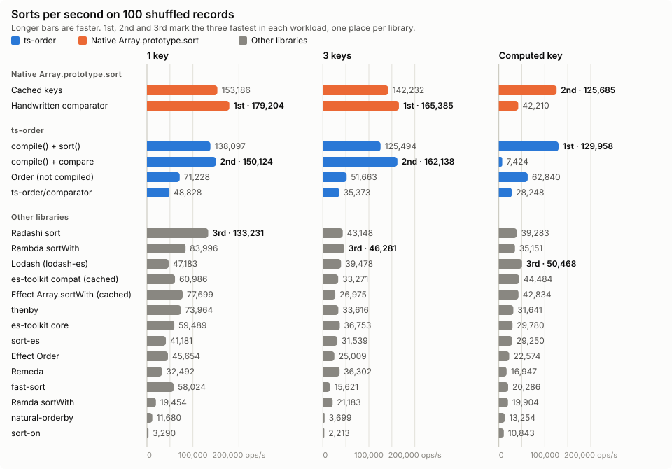
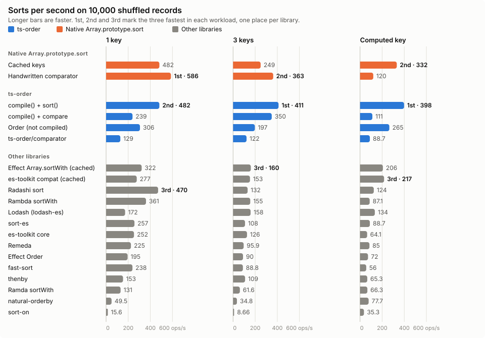
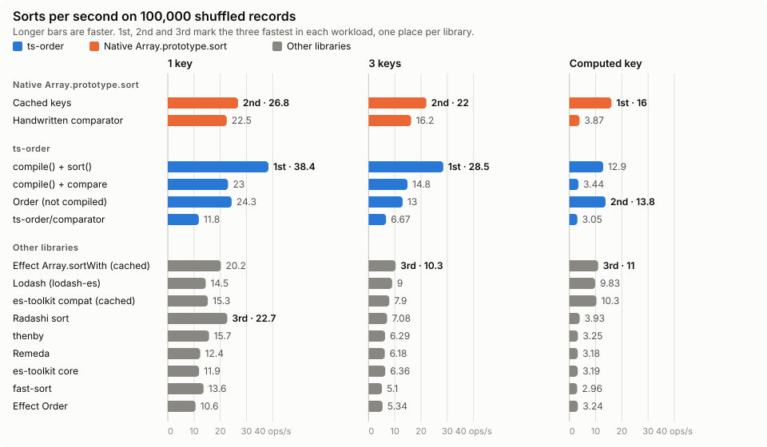
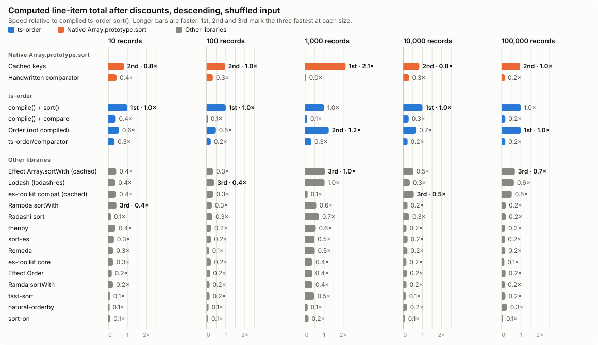
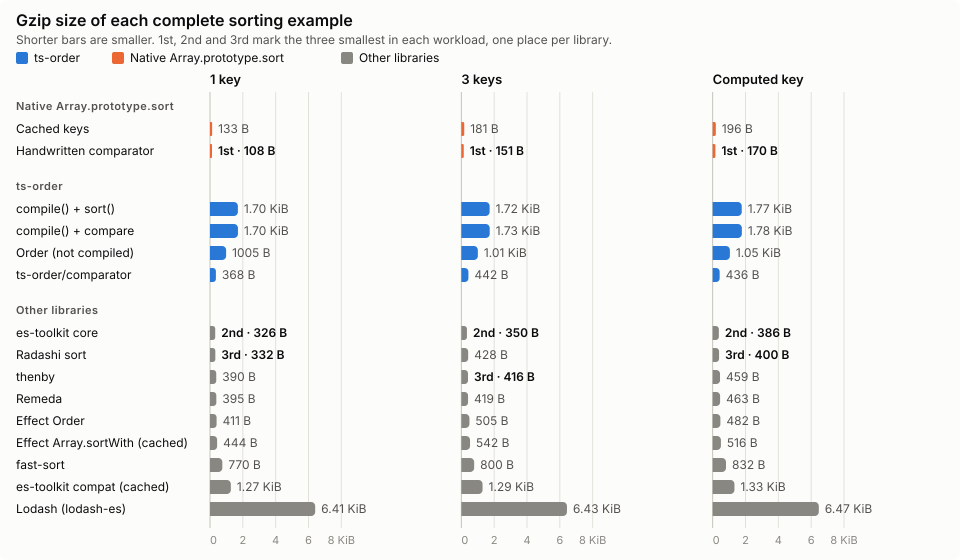

# Sorting benchmarks

## Summary

Sorts per second on **1,000 shuffled records**, a typical list or table. Higher is faster. **(2.0×)** means twice as many sorts per second as compiled ts-order `sort()`. 🥇🥈🥉 mark the three fastest in each column. Each library, and native code, wins at most one medal, with its fastest entry.


| | 1 key | 3 keys | Computed key |
| --- | ---: | ---: | ---: |
| **Native `Array.prototype.sort`** |  |  |  |
| Cached keys | 8,305 ops/s (1.0×) | 5,925 ops/s (0.9×) | 🥇 7,027 ops/s (1.0×) |
| Handwritten comparator | 🥇 9,015 ops/s (1.1×) | 🥈 6,410 ops/s (0.9×) | 2,007 ops/s (0.3×) |
| **ts-order** |  |  |  |
| `compile()` + `sort()` | 🥈 8,392 ops/s (1.0×) | 🥇 6,955 ops/s (1.0×) | 🥈 6,694 ops/s (1.0×) |
| `compile()` + `compare` | 8,214 ops/s (1.0×) | 6,439 ops/s (0.9×) | 2,111 ops/s (0.3×) |
| `Order` (not compiled) | 4,630 ops/s (0.6×) | 3,119 ops/s (0.4×) | 4,098 ops/s (0.6×) |
| `ts-order/comparator` | 3,378 ops/s (0.4×) | 2,085 ops/s (0.3×) | 1,519 ops/s (0.2×) |
| **Other libraries** |  |  |  |
| Radashi sort | 🥉 8,385 ops/s (1.0×) | 2,405 ops/s (0.3×) | 2,170 ops/s (0.3×) |
| Effect Array.sortWith (cached) | 4,816 ops/s (0.6×) | 2,425 ops/s (0.3×) | 3,412 ops/s (0.5×) |
| es-toolkit compat (cached) | 3,973 ops/s (0.5×) | 2,422 ops/s (0.3×) | 🥉 3,588 ops/s (0.5×) |
| Lodash (lodash-es) | 3,658 ops/s (0.4×) | 🥉 2,765 ops/s (0.4×) | 3,347 ops/s (0.5×) |
| thenby | 4,457 ops/s (0.5×) | 1,784 ops/s (0.3×) | 1,612 ops/s (0.2×) |
| es-toolkit core | 3,820 ops/s (0.5×) | 2,142 ops/s (0.3×) | 1,510 ops/s (0.2×) |
| Remeda | 3,486 ops/s (0.4×) | 2,038 ops/s (0.3×) | 1,527 ops/s (0.2×) |
| fast-sort | 3,754 ops/s (0.4×) | 1,516 ops/s (0.2×) | 1,574 ops/s (0.2×) |
| Effect Order | 2,948 ops/s (0.4×) | 1,465 ops/s (0.2×) | 1,296 ops/s (0.2×) |

- **1 key:** stored order total, ascending.
- **3 keys:** fulfillment queue: status ↑, newest first, customer surname ↑.
- **Computed key:** computed line-item total after discounts, descending.
- **†:** more than 20% variation between rounds. Treat close results in that cell with caution.

<details>
<summary>10 records</summary>


| | 1 key | 3 keys | Computed key |
| --- | ---: | ---: | ---: |
| **Native `Array.prototype.sort`** |  |  |  |
| Cached keys | 2,925,767 ops/s (1.0×) | 🥈 2,262,180 ops/s (0.8×) | 🥇 2,057,018 ops/s (1.0×) |
| Handwritten comparator | 🥈 3,476,456 ops/s (1.2×) | 1,333,012 ops/s (0.5×)† | 1,001,185 ops/s (0.5×) |
| **ts-order** |  |  |  |
| `compile()` + `sort()` | 2,808,818 ops/s (1.0×) | 2,668,202 ops/s (1.0×) | 🥈 2,038,597 ops/s (1.0×) |
| `compile()` + `compare` | 🥇 3,491,332 ops/s (1.2×) | 🥇 3,349,852 ops/s (1.3×) | 1,027,012 ops/s (0.5×) |
| `Order` (not compiled) | 1,681,972 ops/s (0.6×)† | 992,398 ops/s (0.4×) | 1,205,300 ops/s (0.6×) |
| `ts-order/comparator` | 1,704,188 ops/s (0.6×)† | 917,662 ops/s (0.3×) | 675,826 ops/s (0.3×) |
| **Other libraries** |  |  |  |
| Radashi sort | 🥉 3,244,715 ops/s (1.2×) | 🥉 1,780,182 ops/s (0.7×)† | 1,014,081 ops/s (0.5×) |
| thenby | 2,274,540 ops/s (0.8×)† | 998,313 ops/s (0.4×) | 817,697 ops/s (0.4×) |
| Effect Array.sortWith (cached) | 1,821,356 ops/s (0.6×) | 925,776 ops/s (0.3×) | 998,362 ops/s (0.5×) |
| es-toolkit core | 1,762,172 ops/s (0.6×)† | 1,035,693 ops/s (0.4×) | 718,115 ops/s (0.4×) |
| Remeda | 1,796,225 ops/s (0.6×)† | 944,353 ops/s (0.4×) | 717,576 ops/s (0.4×) |
| Lodash (lodash-es) | 1,127,749 ops/s (0.4×)† | 745,394 ops/s (0.3×) | 887,863 ops/s (0.4×) |
| es-toolkit compat (cached) | 1,246,254 ops/s (0.4×) | 523,364 ops/s (0.2×) | 🥉 1,023,712 ops/s (0.5×) |
| fast-sort | 1,720,895 ops/s (0.6×)† | 504,168 ops/s (0.2×) | 714,379 ops/s (0.4×) |
| Effect Order | 1,391,130 ops/s (0.5×)† | 588,757 ops/s (0.2×) | 566,218 ops/s (0.3×) |

</details>

<details>
<summary>100 records</summary>



| | 1 key | 3 keys | Computed key |
| --- | ---: | ---: | ---: |
| **Native `Array.prototype.sort`** |  |  |  |
| Cached keys | 153,726 ops/s (1.0×) | 147,784 ops/s (0.9×) | 🥇 138,464 ops/s (1.0×) |
| Handwritten comparator | 🥇 186,678 ops/s (1.2×) | 🥈 167,270 ops/s (1.0×) | 45,926 ops/s (0.3×) |
| **ts-order** |  |  |  |
| `compile()` + `sort()` | 158,238 ops/s (1.0×) | 163,250 ops/s (1.0×) | 🥈 136,948 ops/s (1.0×) |
| `compile()` + `compare` | 🥈 179,565 ops/s (1.1×) | 🥇 173,348 ops/s (1.1×) | 46,240 ops/s (0.3×) |
| `Order` (not compiled) | 75,665 ops/s (0.5×) | 53,008 ops/s (0.3×) | 67,097 ops/s (0.5×) |
| `ts-order/comparator` | 54,228 ops/s (0.3×) | 33,123 ops/s (0.2×) | 28,979 ops/s (0.2×) |
| **Other libraries** |  |  |  |
| Radashi sort | 🥉 171,799 ops/s (1.1×) | 44,492 ops/s (0.3×) | 44,513 ops/s (0.3×) |
| Effect Array.sortWith (cached) | 77,832 ops/s (0.5×) | 39,981 ops/s (0.2×) | 54,903 ops/s (0.4×) |
| es-toolkit compat (cached) | 64,959 ops/s (0.4×) | 35,909 ops/s (0.2×) | 🥉 57,466 ops/s (0.4×) |
| Lodash (lodash-es) | 54,547 ops/s (0.3×) | 🥉 44,977 ops/s (0.3×) | 52,083 ops/s (0.4×) |
| thenby | 76,203 ops/s (0.5×) | 34,163 ops/s (0.2×) | 34,238 ops/s (0.3×) |
| es-toolkit core | 63,930 ops/s (0.4×) | 38,276 ops/s (0.2×) | 29,845 ops/s (0.2×) |
| Remeda | 55,421 ops/s (0.4×) | 36,998 ops/s (0.2×) | 30,851 ops/s (0.2×) |
| fast-sort | 59,532 ops/s (0.4×) | 27,007 ops/s (0.2×) | 30,666 ops/s (0.2×) |
| Effect Order | 47,111 ops/s (0.3×) | 25,642 ops/s (0.2×) | 23,996 ops/s (0.2×) |

</details>

<details>
<summary>10,000 records</summary>



| | 1 key | 3 keys | Computed key |
| --- | ---: | ---: | ---: |
| **Native `Array.prototype.sort`** |  |  |  |
| Cached keys | 584 ops/s (1.0×) | 🥈 397 ops/s (0.9×) | 🥈 444 ops/s (1.0×) |
| Handwritten comparator | 🥇 596 ops/s (1.0×) | 385 ops/s (0.9×) | 121 ops/s (0.3×) |
| **ts-order** |  |  |  |
| `compile()` + `sort()` | 🥈 579 ops/s (1.0×) | 🥇 428 ops/s (1.0×) | 🥇 448 ops/s (1.0×) |
| `compile()` + `compare` | 539 ops/s (0.9×) | 358 ops/s (0.8×) | 128 ops/s (0.3×) |
| `Order` (not compiled) | 336 ops/s (0.6×) | 211 ops/s (0.5×) | 282 ops/s (0.6×) |
| `ts-order/comparator` | 230 ops/s (0.4×) | 132 ops/s (0.3×) | 94.1 ops/s (0.2×) |
| **Other libraries** |  |  |  |
| Effect Array.sortWith (cached) | 353 ops/s (0.6×) | 167 ops/s (0.4×) | 229 ops/s (0.5×) |
| es-toolkit compat (cached) | 285 ops/s (0.5×) | 166 ops/s (0.4×) | 🥉 240 ops/s (0.5×) |
| Lodash (lodash-es) | 264 ops/s (0.5×) | 🥉 172 ops/s (0.4×) | 213 ops/s (0.5×) |
| Radashi sort | 🥉 555 ops/s (1.0×) | 147 ops/s (0.3×) | 119 ops/s (0.3×) |
| thenby | 311 ops/s (0.5×) | 122 ops/s (0.3×) | 101 ops/s (0.2×) |
| es-toolkit core | 266 ops/s (0.5×) | 136 ops/s (0.3×) | 94.2 ops/s (0.2×) |
| Remeda | 244 ops/s (0.4×) | 126 ops/s (0.3×) | 86.9 ops/s (0.2×) |
| fast-sort | 270 ops/s (0.5×) | 95.6 ops/s (0.2×) | 95.1 ops/s (0.2×) |
| Effect Order | 211 ops/s (0.4×) | 88.5 ops/s (0.2×) | 84.4 ops/s (0.2×) |

</details>

<details>
<summary>100,000 records</summary>



| | 1 key | 3 keys | Computed key |
| --- | ---: | ---: | ---: |
| **Native `Array.prototype.sort`** |  |  |  |
| Cached keys | 🥈 26.8 ops/s (0.7×) | 🥈 22 ops/s (0.8×) | 🥇 16 ops/s (1.2×) |
| Handwritten comparator | 22.5 ops/s (0.6×) | 16.2 ops/s (0.6×) | 3.87 ops/s (0.3×) |
| **ts-order** |  |  |  |
| `compile()` + `sort()` | 🥇 38.4 ops/s (1.0×) | 🥇 28.5 ops/s (1.0×) | 12.9 ops/s (1.0×)† |
| `compile()` + `compare` | 23 ops/s (0.6×) | 14.8 ops/s (0.5×) | 3.44 ops/s (0.3×) |
| `Order` (not compiled) | 24.3 ops/s (0.6×) | 13 ops/s (0.5×) | 🥈 13.8 ops/s (1.1×) |
| `ts-order/comparator` | 11.8 ops/s (0.3×) | 6.67 ops/s (0.2×) | 3.05 ops/s (0.2×) |
| **Other libraries** |  |  |  |
| Effect Array.sortWith (cached) | 20.2 ops/s (0.5×) | 🥉 10.3 ops/s (0.4×) | 🥉 11 ops/s (0.9×) |
| Lodash (lodash-es) | 14.5 ops/s (0.4×) | 9 ops/s (0.3×) | 9.83 ops/s (0.8×) |
| es-toolkit compat (cached) | 15.3 ops/s (0.4×) | 7.9 ops/s (0.3×) | 10.3 ops/s (0.8×) |
| Radashi sort | 🥉 22.7 ops/s (0.6×) | 7.08 ops/s (0.2×) | 3.93 ops/s (0.3×) |
| thenby | 15.7 ops/s (0.4×) | 6.29 ops/s (0.2×) | 3.25 ops/s (0.3×) |
| Remeda | 12.4 ops/s (0.3×) | 6.18 ops/s (0.2×) | 3.18 ops/s (0.2×) |
| es-toolkit core | 11.9 ops/s (0.3×) | 6.36 ops/s (0.2×) | 3.19 ops/s (0.2×) |
| fast-sort | 13.6 ops/s (0.4×) | 5.1 ops/s (0.2×) | 2.96 ops/s (0.2×) |
| Effect Order | 10.6 ops/s (0.3×) | 5.34 ops/s (0.2×) | 3.24 ops/s (0.3×) |

</details>

[Interactive ranked charts](BENCHMARKS.html) · [Historical exhaustive run, before review fixes](benchmarks/full.md)

Measured sizes: **10, 100, 1,000, 10,000, 100,000** records · 2 rounds · shuffled input.

**Short profile:** lower sampling budgets. Use for iteration, not definitive performance claims.

## Runtime results

The code behind every row is listed under [Sorting code](#sorting-code).

Same format as the summary: sorts per second, then the speed relative to compiled ts-order `sort()`. 🥇🥈🥉 mark the three fastest in each column, one medal per library. Expand the variation table before you trust a close result.

### Stored order total, ascending

#### shuffled


| | 10 | 100 | 1,000 | 10,000 | 100,000 |
| --- | ---: | ---: | ---: | ---: | ---: |
| **Native `Array.prototype.sort`** |  |  |  |  |  |
| Cached keys | 2,925,767 ops/s (1.0×) | 153,726 ops/s (1.0×) | 8,305 ops/s (1.0×) | 584 ops/s (1.0×) | 🥈 26.8 ops/s (0.7×) |
| Handwritten comparator | 🥈 3,476,456 ops/s (1.2×) | 🥇 186,678 ops/s (1.2×) | 🥇 9,015 ops/s (1.1×) | 🥇 596 ops/s (1.0×) | 22.5 ops/s (0.6×) |
| **ts-order** |  |  |  |  |  |
| `compile()` + `sort()` | 2,808,818 ops/s (1.0×) | 158,238 ops/s (1.0×) | 🥈 8,392 ops/s (1.0×) | 🥈 579 ops/s (1.0×) | 🥇 38.4 ops/s (1.0×) |
| `compile()` + `compare` | 🥇 3,491,332 ops/s (1.2×) | 🥈 179,565 ops/s (1.1×) | 8,214 ops/s (1.0×) | 539 ops/s (0.9×) | 23 ops/s (0.6×) |
| `Order` (not compiled) | 1,681,972 ops/s (0.6×)† | 75,665 ops/s (0.5×) | 4,630 ops/s (0.6×) | 336 ops/s (0.6×) | 24.3 ops/s (0.6×) |
| `ts-order/comparator` | 1,704,188 ops/s (0.6×)† | 54,228 ops/s (0.3×) | 3,378 ops/s (0.4×) | 230 ops/s (0.4×) | 11.8 ops/s (0.3×) |
| **Other libraries** |  |  |  |  |  |
| Radashi sort | 🥉 3,244,715 ops/s (1.2×) | 🥉 171,799 ops/s (1.1×) | 🥉 8,385 ops/s (1.0×) | 🥉 555 ops/s (1.0×) | 🥉 22.7 ops/s (0.6×) |
| Effect Array.sortWith (cached) | 1,821,356 ops/s (0.6×) | 77,832 ops/s (0.5×) | 4,816 ops/s (0.6×) | 353 ops/s (0.6×) | 20.2 ops/s (0.5×) |
| thenby | 2,274,540 ops/s (0.8×)† | 76,203 ops/s (0.5×) | 4,457 ops/s (0.5×) | 311 ops/s (0.5×) | 15.7 ops/s (0.4×) |
| fast-sort | 1,720,895 ops/s (0.6×)† | 59,532 ops/s (0.4×) | 3,754 ops/s (0.4×) | 270 ops/s (0.5×) | 13.6 ops/s (0.4×) |
| es-toolkit compat (cached) | 1,246,254 ops/s (0.4×) | 64,959 ops/s (0.4×) | 3,973 ops/s (0.5×) | 285 ops/s (0.5×) | 15.3 ops/s (0.4×) |
| es-toolkit core | 1,762,172 ops/s (0.6×)† | 63,930 ops/s (0.4×) | 3,820 ops/s (0.5×) | 266 ops/s (0.5×) | 11.9 ops/s (0.3×) |
| Remeda | 1,796,225 ops/s (0.6×)† | 55,421 ops/s (0.4×) | 3,486 ops/s (0.4×) | 244 ops/s (0.4×) | 12.4 ops/s (0.3×) |
| Lodash (lodash-es) | 1,127,749 ops/s (0.4×)† | 54,547 ops/s (0.3×) | 3,658 ops/s (0.4×) | 264 ops/s (0.5×) | 14.5 ops/s (0.4×) |
| Effect Order | 1,391,130 ops/s (0.5×)† | 47,111 ops/s (0.3×) | 2,948 ops/s (0.4×) | 211 ops/s (0.4×) | 10.6 ops/s (0.3×) |

<details>
<summary>Round-to-round variation (not confidence intervals)</summary>

| Implementation | 10 | 100 | 1,000 | 10,000 | 100,000 |
| --- | ---: | ---: | ---: | ---: | ---: |
| **Native `Array.prototype.sort`** |  |  |  |  |  |
| Cached keys | ±6% | ±10% | ±5% | ±5% | ±3% |
| Handwritten comparator | ±0% | ±0% | ±0% | ±7% | ±10% |
| **ts-order** |  |  |  |  |  |
| `compile()` + `sort()` | ±3% | ±5% | ±0% | ±1% | ±4% |
| `compile()` + `compare` | ±8% | ±2% | ±2% | ±6% | ±4% |
| `Order` (not compiled) | ±20% | ±4% | ±0% | ±3% | ±1% |
| `ts-order/comparator` | ±54% | ±3% | ±1% | ±7% | ±4% |
| **Other libraries** |  |  |  |  |  |
| Radashi sort | ±5% | ±0% | ±1% | ±4% | ±7% |
| Effect Array.sortWith (cached) | ±17% | ±5% | ±1% | ±2% | ±5% |
| thenby | ±39% | ±5% | ±1% | ±6% | ±5% |
| fast-sort | ±41% | ±4% | ±1% | ±6% | ±7% |
| es-toolkit compat (cached) | ±10% | ±3% | ±0% | ±1% | ±5% |
| es-toolkit core | ±30% | ±3% | ±1% | ±6% | ±7% |
| Remeda | ±49% | ±1% | ±0% | ±6% | ±2% |
| Lodash (lodash-es) | ±23% | ±6% | ±0% | ±3% | ±5% |
| Effect Order | ±42% | ±2% | ±1% | ±3% | ±3% |

</details>

### Fulfillment queue: status ↑, newest first, customer surname ↑

#### shuffled


| | 10 | 100 | 1,000 | 10,000 | 100,000 |
| --- | ---: | ---: | ---: | ---: | ---: |
| **Native `Array.prototype.sort`** |  |  |  |  |  |
| Cached keys | 🥈 2,262,180 ops/s (0.8×) | 147,784 ops/s (0.9×) | 5,925 ops/s (0.9×) | 🥈 397 ops/s (0.9×) | 🥈 22 ops/s (0.8×) |
| Handwritten comparator | 1,333,012 ops/s (0.5×)† | 🥈 167,270 ops/s (1.0×) | 🥈 6,410 ops/s (0.9×) | 385 ops/s (0.9×) | 16.2 ops/s (0.6×) |
| **ts-order** |  |  |  |  |  |
| `compile()` + `sort()` | 2,668,202 ops/s (1.0×) | 163,250 ops/s (1.0×) | 🥇 6,955 ops/s (1.0×) | 🥇 428 ops/s (1.0×) | 🥇 28.5 ops/s (1.0×) |
| `compile()` + `compare` | 🥇 3,349,852 ops/s (1.3×) | 🥇 173,348 ops/s (1.1×) | 6,439 ops/s (0.9×) | 358 ops/s (0.8×) | 14.8 ops/s (0.5×) |
| `Order` (not compiled) | 992,398 ops/s (0.4×) | 53,008 ops/s (0.3×) | 3,119 ops/s (0.4×) | 211 ops/s (0.5×) | 13 ops/s (0.5×) |
| `ts-order/comparator` | 917,662 ops/s (0.3×) | 33,123 ops/s (0.2×) | 2,085 ops/s (0.3×) | 132 ops/s (0.3×) | 6.67 ops/s (0.2×) |
| **Other libraries** |  |  |  |  |  |
| Radashi sort | 🥉 1,780,182 ops/s (0.7×)† | 44,492 ops/s (0.3×) | 2,405 ops/s (0.3×) | 147 ops/s (0.3×) | 7.08 ops/s (0.2×) |
| Effect Array.sortWith (cached) | 925,776 ops/s (0.3×) | 39,981 ops/s (0.2×) | 2,425 ops/s (0.3×) | 167 ops/s (0.4×) | 🥉 10.3 ops/s (0.4×) |
| Lodash (lodash-es) | 745,394 ops/s (0.3×) | 🥉 44,977 ops/s (0.3×) | 🥉 2,765 ops/s (0.4×) | 🥉 172 ops/s (0.4×) | 9 ops/s (0.3×) |
| es-toolkit core | 1,035,693 ops/s (0.4×) | 38,276 ops/s (0.2×) | 2,142 ops/s (0.3×) | 136 ops/s (0.3×) | 6.36 ops/s (0.2×) |
| es-toolkit compat (cached) | 523,364 ops/s (0.2×) | 35,909 ops/s (0.2×) | 2,422 ops/s (0.3×) | 166 ops/s (0.4×) | 7.9 ops/s (0.3×) |
| Remeda | 944,353 ops/s (0.4×) | 36,998 ops/s (0.2×) | 2,038 ops/s (0.3×) | 126 ops/s (0.3×) | 6.18 ops/s (0.2×) |
| thenby | 998,313 ops/s (0.4×) | 34,163 ops/s (0.2×) | 1,784 ops/s (0.3×) | 122 ops/s (0.3×) | 6.29 ops/s (0.2×) |
| Effect Order | 588,757 ops/s (0.2×) | 25,642 ops/s (0.2×) | 1,465 ops/s (0.2×) | 88.5 ops/s (0.2×) | 5.34 ops/s (0.2×) |
| fast-sort | 504,168 ops/s (0.2×) | 27,007 ops/s (0.2×) | 1,516 ops/s (0.2×) | 95.6 ops/s (0.2×) | 5.1 ops/s (0.2×) |

<details>
<summary>Round-to-round variation (not confidence intervals)</summary>

| Implementation | 10 | 100 | 1,000 | 10,000 | 100,000 |
| --- | ---: | ---: | ---: | ---: | ---: |
| **Native `Array.prototype.sort`** |  |  |  |  |  |
| Cached keys | ±9% | ±3% | ±4% | ±2% | ±7% |
| Handwritten comparator | ±58% | ±3% | ±3% | ±2% | ±3% |
| **ts-order** |  |  |  |  |  |
| `compile()` + `sort()` | ±2% | ±4% | ±1% | ±2% | ±3% |
| `compile()` + `compare` | ±1% | ±1% | ±1% | ±5% | ±9% |
| `Order` (not compiled) | ±1% | ±2% | ±1% | ±2% | ±2% |
| `ts-order/comparator` | ±3% | ±10% | ±0% | ±4% | ±3% |
| **Other libraries** |  |  |  |  |  |
| Radashi sort | ±37% | ±3% | ±2% | ±4% | ±6% |
| Effect Array.sortWith (cached) | ±2% | ±1% | ±0% | ±1% | ±1% |
| Lodash (lodash-es) | ±4% | ±3% | ±1% | ±2% | ±7% |
| es-toolkit core | ±2% | ±3% | ±0% | ±3% | ±1% |
| es-toolkit compat (cached) | ±1% | ±1% | ±1% | ±3% | ±2% |
| Remeda | ±8% | ±4% | ±1% | ±4% | ±2% |
| thenby | ±8% | ±3% | ±6% | ±2% | ±4% |
| Effect Order | ±10% | ±3% | ±0% | ±3% | ±2% |
| fast-sort | ±4% | ±2% | ±0% | ±1% | ±2% |

</details>

### Computed line-item total after discounts, descending

#### shuffled



| | 10 | 100 | 1,000 | 10,000 | 100,000 |
| --- | ---: | ---: | ---: | ---: | ---: |
| **Native `Array.prototype.sort`** |  |  |  |  |  |
| Cached keys | 🥇 2,057,018 ops/s (1.0×) | 🥇 138,464 ops/s (1.0×) | 🥇 7,027 ops/s (1.0×) | 🥈 444 ops/s (1.0×) | 🥇 16 ops/s (1.2×) |
| Handwritten comparator | 1,001,185 ops/s (0.5×) | 45,926 ops/s (0.3×) | 2,007 ops/s (0.3×) | 121 ops/s (0.3×) | 3.87 ops/s (0.3×) |
| **ts-order** |  |  |  |  |  |
| `compile()` + `sort()` | 🥈 2,038,597 ops/s (1.0×) | 🥈 136,948 ops/s (1.0×) | 🥈 6,694 ops/s (1.0×) | 🥇 448 ops/s (1.0×) | 12.9 ops/s (1.0×)† |
| `compile()` + `compare` | 1,027,012 ops/s (0.5×) | 46,240 ops/s (0.3×) | 2,111 ops/s (0.3×) | 128 ops/s (0.3×) | 3.44 ops/s (0.3×) |
| `Order` (not compiled) | 1,205,300 ops/s (0.6×) | 67,097 ops/s (0.5×) | 4,098 ops/s (0.6×) | 282 ops/s (0.6×) | 🥈 13.8 ops/s (1.1×) |
| `ts-order/comparator` | 675,826 ops/s (0.3×) | 28,979 ops/s (0.2×) | 1,519 ops/s (0.2×) | 94.1 ops/s (0.2×) | 3.05 ops/s (0.2×) |
| **Other libraries** |  |  |  |  |  |
| es-toolkit compat (cached) | 🥉 1,023,712 ops/s (0.5×) | 🥉 57,466 ops/s (0.4×) | 🥉 3,588 ops/s (0.5×) | 🥉 240 ops/s (0.5×) | 10.3 ops/s (0.8×) |
| Effect Array.sortWith (cached) | 998,362 ops/s (0.5×) | 54,903 ops/s (0.4×) | 3,412 ops/s (0.5×) | 229 ops/s (0.5×) | 🥉 11 ops/s (0.9×) |
| Lodash (lodash-es) | 887,863 ops/s (0.4×) | 52,083 ops/s (0.4×) | 3,347 ops/s (0.5×) | 213 ops/s (0.5×) | 9.83 ops/s (0.8×) |
| Radashi sort | 1,014,081 ops/s (0.5×) | 44,513 ops/s (0.3×) | 2,170 ops/s (0.3×) | 119 ops/s (0.3×) | 3.93 ops/s (0.3×) |
| thenby | 817,697 ops/s (0.4×) | 34,238 ops/s (0.3×) | 1,612 ops/s (0.2×) | 101 ops/s (0.2×) | 3.25 ops/s (0.3×) |
| es-toolkit core | 718,115 ops/s (0.4×) | 29,845 ops/s (0.2×) | 1,510 ops/s (0.2×) | 94.2 ops/s (0.2×) | 3.19 ops/s (0.2×) |
| fast-sort | 714,379 ops/s (0.4×) | 30,666 ops/s (0.2×) | 1,574 ops/s (0.2×) | 95.1 ops/s (0.2×) | 2.96 ops/s (0.2×) |
| Remeda | 717,576 ops/s (0.4×) | 30,851 ops/s (0.2×) | 1,527 ops/s (0.2×) | 86.9 ops/s (0.2×) | 3.18 ops/s (0.2×) |
| Effect Order | 566,218 ops/s (0.3×) | 23,996 ops/s (0.2×) | 1,296 ops/s (0.2×) | 84.4 ops/s (0.2×) | 3.24 ops/s (0.3×) |

<details>
<summary>Round-to-round variation (not confidence intervals)</summary>

| Implementation | 10 | 100 | 1,000 | 10,000 | 100,000 |
| --- | ---: | ---: | ---: | ---: | ---: |
| **Native `Array.prototype.sort`** |  |  |  |  |  |
| Cached keys | ±1% | ±0% | ±4% | ±5% | ±5% |
| Handwritten comparator | ±4% | ±2% | ±3% | ±4% | ±3% |
| **ts-order** |  |  |  |  |  |
| `compile()` + `sort()` | ±0% | ±0% | ±3% | ±3% | ±24% |
| `compile()` + `compare` | ±2% | ±2% | ±4% | ±7% | ±6% |
| `Order` (not compiled) | ±1% | ±0% | ±4% | ±4% | ±3% |
| `ts-order/comparator` | ±8% | ±1% | ±4% | ±2% | ±5% |
| **Other libraries** |  |  |  |  |  |
| es-toolkit compat (cached) | ±0% | ±0% | ±1% | ±4% | ±8% |
| Effect Array.sortWith (cached) | ±2% | ±0% | ±2% | ±7% | ±6% |
| Lodash (lodash-es) | ±1% | ±2% | ±3% | ±3% | ±7% |
| Radashi sort | ±3% | ±7% | ±4% | ±12% | ±2% |
| thenby | ±3% | ±1% | ±0% | ±8% | ±1% |
| es-toolkit core | ±4% | ±2% | ±4% | ±4% | ±3% |
| fast-sort | ±2% | ±4% | ±5% | ±2% | ±4% |
| Remeda | ±4% | ±3% | ±4% | ±10% | ±1% |
| Effect Order | ±4% | ±1% | ±3% | ±3% | ±3% |

</details>

## Bundle overhead

Each result is a **complete working sorting example**, not an npm install size or the whole library. The same code used for timing is bundled individually for each workload. The native baseline contains the equivalent handwritten comparator. Each emitted bundle is executed and checked against the same reference before its size is accepted.

esbuild bundles for browser ESM / ES2022 with minification, tree shaking and legal comments removed; gzip uses level 9. No source maps, external packages, runtime polyfills, data fixtures or benchmark runner are included. ts-order resolves to its built public exports. Application glue and selector code are included; native rows show the no-library cost. Each example is written for its workload, with the selectors inline, as an application would write it. The code is listed under **Sorting code**.



Each cell is the **gzip size** of the whole example, then in brackets the extra gzip over the no-library handwritten example. 🥇🥈🥉 mark the three smallest in each column, one medal per library. B = bytes; KiB = 1,024 bytes. Deltas are example overhead, not context-independent library sizes: compression and shared application code are non-additive.

| | 1 key | 3 keys | Computed key |
| --- | ---: | ---: | ---: |
| **Native `Array.prototype.sort`** |  |  |  |
| Cached keys | 133 B (+25 B) | 181 B (+30 B) | 196 B (+26 B) |
| Handwritten comparator | 🥇 108 B (0 B) | 🥇 151 B (0 B) | 🥇 170 B (0 B) |
| **ts-order** |  |  |  |
| `compile()` + `sort()` | 1.70 KiB (+1.59 KiB) | 1.72 KiB (+1.58 KiB) | 1.77 KiB (+1.60 KiB) |
| `compile()` + `compare` | 1.70 KiB (+1.60 KiB) | 1.73 KiB (+1.58 KiB) | 1.78 KiB (+1.61 KiB) |
| `Order` (not compiled) | 1005 B (+897 B) | 1.01 KiB (+879 B) | 1.05 KiB (+904 B) |
| `ts-order/comparator` | 368 B (+260 B) | 442 B (+291 B) | 436 B (+266 B) |
| **Other libraries** |  |  |  |
| es-toolkit core | 🥈 326 B (+218 B) | 🥈 350 B (+199 B) | 🥈 386 B (+216 B) |
| Radashi sort | 🥉 332 B (+224 B) | 428 B (+277 B) | 🥉 400 B (+230 B) |
| thenby | 390 B (+282 B) | 🥉 416 B (+265 B) | 459 B (+289 B) |
| Remeda | 395 B (+287 B) | 419 B (+268 B) | 463 B (+293 B) |
| Effect Order | 411 B (+303 B) | 505 B (+354 B) | 482 B (+312 B) |
| Effect Array.sortWith (cached) | 444 B (+336 B) | 542 B (+391 B) | 516 B (+346 B) |
| fast-sort | 770 B (+662 B) | 800 B (+649 B) | 832 B (+662 B) |
| es-toolkit compat (cached) | 1.27 KiB (+1.16 KiB) | 1.29 KiB (+1.15 KiB) | 1.33 KiB (+1.16 KiB) |
| Lodash (lodash-es) | 6.41 KiB (+6.30 KiB) | 6.43 KiB (+6.29 KiB) | 6.47 KiB (+6.30 KiB) |

<details>
<summary>Minified sizes, before gzip</summary>

| | 1 key | 3 keys | Computed key |
| --- | ---: | ---: | ---: |
| **Native `Array.prototype.sort`** |  |  |  |
| Cached keys | 138 B | 273 B | 242 B |
| Handwritten comparator | 103 B | 210 B | 199 B |
| **ts-order** |  |  |  |
| `compile()` + `sort()` | 4.08 KiB | 4.14 KiB | 4.20 KiB |
| `compile()` + `compare` | 4.10 KiB | 4.16 KiB | 4.21 KiB |
| `Order` (not compiled) | 2.26 KiB | 2.32 KiB | 2.37 KiB |
| `ts-order/comparator` | 607 B | 768 B | 724 B |
| **Other libraries** |  |  |  |
| es-toolkit core | 491 B | 538 B | 590 B |
| Radashi sort | 570 B | 740 B | 675 B |
| thenby | 695 B | 752 B | 800 B |
| Remeda | 671 B | 714 B | 778 B |
| Effect Order | 840 B | 1.04 KiB | 979 B |
| Effect Array.sortWith (cached) | 902 B | 1.09 KiB | 1.02 KiB |
| fast-sort | 1.61 KiB | 1.66 KiB | 1.70 KiB |
| es-toolkit compat (cached) | 2.72 KiB | 2.76 KiB | 2.82 KiB |
| Lodash (lodash-es) | 16.81 KiB | 16.86 KiB | 16.91 KiB |

</details>

## Sorting code

The exact code that was timed and bundled, for every implementation and workload. Each module in `benchmarks/adapters/` exports one function per workload. That function runs once, before timing, to prepare any reusable definition. The function it returns is the one timed. Imports of the shared `Purchase` type, `Sorter` type and `computedTotal` helper from `benchmarks/cases.ts` are left out; `computedTotal` sums the discounted line items, rounding each line to cents.

### Stored order total, ascending

#### Native handwritten

```ts
export function total(): Sorter {
	return (purchases) =>
		purchases.toSorted((a, b) => a.totalCents - b.totalCents);
}
```

#### Native cached keys

```ts
export function total(): Sorter {
	return (purchases) =>
		purchases
			.map((value) => ({ value, key: value.totalCents }))
			.sort((a, b) => a.key - b.key)
			.map((entry) => entry.value);
}
```

#### ts-order class

```ts
import { Order } from 'ts-order';

export function total(): Sorter {
	const byTotal = new Order<Purchase>().by((purchase) => purchase.totalCents);
	return (purchases) => byTotal.sort(purchases);
}
```

#### ts-order comparator

```ts
import { by, order } from 'ts-order/comparator';

export function total(): Sorter {
	const compare = by((purchase: Purchase) => purchase.totalCents);
	return (purchases) => purchases.toSorted(compare);
}
```

#### ts-order compiled sort

```ts
import { compile, Order } from 'ts-order';

export function total(): Sorter {
	const byTotal = compile(
		new Order<Purchase>().by((purchase) => purchase.totalCents),
	);
	return (purchases) => byTotal.sort(purchases);
}
```

#### ts-order compiled compare

```ts
import { compile, Order } from 'ts-order';

export function total(): Sorter {
	const { compare } = compile(
		new Order<Purchase>().by((purchase) => purchase.totalCents),
	);
	return (purchases) => purchases.toSorted(compare);
}
```

#### Lodash (lodash-es)

```ts
import { orderBy } from 'lodash-es';

export function total(): Sorter {
	return (purchases) =>
		orderBy(
			purchases,
			[(purchase: Purchase) => purchase.totalCents],
			['asc'],
		);
}
```

#### es-toolkit core

```ts
import { orderBy } from 'es-toolkit/array';

export function total(): Sorter {
	return (purchases) =>
		orderBy(
			purchases,
			[(purchase: Purchase) => purchase.totalCents],
			['asc'],
		);
}
```

#### es-toolkit compat (cached)

```ts
import { orderBy } from 'es-toolkit/compat';

export function total(): Sorter {
	return (purchases) =>
		orderBy(
			purchases,
			[(purchase: Purchase) => purchase.totalCents],
			['asc'],
		);
}
```

#### fast-sort

```ts
import { sort } from 'fast-sort';

export function total(): Sorter {
	return (purchases) =>
		sort(purchases).asc((purchase) => purchase.totalCents);
}
```

#### Remeda

```ts
import { sortBy } from 'remeda';

export function total(): Sorter {
	return sortBy<readonly Purchase[]>((purchase) => purchase.totalCents);
}
```

#### thenby

```ts
import { firstBy } from 'thenby';

export function total(): Sorter {
	const compare = firstBy((purchase: Purchase) => purchase.totalCents);
	return (purchases) => purchases.toSorted(compare);
}
```

#### Effect Order

```ts
import * as Order from 'effect/Order';

export function total(): Sorter {
	const compare = Order.mapInput(
		Order.Number,
		(purchase: Purchase) => purchase.totalCents,
	);
	return (purchases) => purchases.toSorted(compare);
}
```

#### Effect Array.sortWith (cached)

```ts
import * as EffectArray from 'effect/Array';
import * as Order from 'effect/Order';

export function total(): Sorter {
	return EffectArray.sortWith<readonly Purchase[], number>(
		(purchase) => purchase.totalCents,
		Order.Number,
	);
}
```

#### Radashi sort

```ts
import { castComparator, sort } from 'radashi';

export function total(): Sorter {
	return (purchases) => sort(purchases, (purchase) => purchase.totalCents);
}
```

### Fulfillment queue: status ↑, newest first, customer surname ↑

#### Native handwritten

```ts
export function fulfillment(): Sorter {
	return (purchases) =>
		purchases.toSorted(
			(a, b) =>
				a.status - b.status ||
				b.createdAt - a.createdAt ||
				(a.customer.lastName < b.customer.lastName
					? -1
					: a.customer.lastName > b.customer.lastName
						? 1
						: 0),
		);
}
```

#### Native cached keys

```ts
export function fulfillment(): Sorter {
	return (purchases) =>
		purchases
			.map((value) => ({
				value,
				status: value.status,
				createdAt: value.createdAt,
				lastName: value.customer.lastName,
			}))
			.sort(
				(a, b) =>
					a.status - b.status ||
					b.createdAt - a.createdAt ||
					(a.lastName < b.lastName
						? -1
						: a.lastName > b.lastName
							? 1
							: 0),
			)
			.map((entry) => entry.value);
}
```

#### ts-order class

```ts
import { Order } from 'ts-order';

export function fulfillment(): Sorter {
	const queue = new Order<Purchase>()
		.by((purchase) => purchase.status)
		.by((purchase) => purchase.createdAt, { direction: 'desc' })
		.by((purchase) => purchase.customer.lastName);
	return (purchases) => queue.sort(purchases);
}
```

#### ts-order comparator

```ts
import { by, order } from 'ts-order/comparator';

export function fulfillment(): Sorter {
	const compare = order(
		by((purchase: Purchase) => purchase.status),
		by((purchase: Purchase) => purchase.createdAt, { direction: 'desc' }),
		by((purchase: Purchase) => purchase.customer.lastName),
	);
	return (purchases) => purchases.toSorted(compare);
}
```

#### ts-order compiled sort

```ts
import { compile, Order } from 'ts-order';

export function fulfillment(): Sorter {
	const queue = compile(
		new Order<Purchase>()
			.by((purchase) => purchase.status)
			.by((purchase) => purchase.createdAt, { direction: 'desc' })
			.by((purchase) => purchase.customer.lastName),
	);
	return (purchases) => queue.sort(purchases);
}
```

#### ts-order compiled compare

```ts
import { compile, Order } from 'ts-order';

export function fulfillment(): Sorter {
	const { compare } = compile(
		new Order<Purchase>()
			.by((purchase) => purchase.status)
			.by((purchase) => purchase.createdAt, { direction: 'desc' })
			.by((purchase) => purchase.customer.lastName),
	);
	return (purchases) => purchases.toSorted(compare);
}
```

#### Lodash (lodash-es)

```ts
import { orderBy } from 'lodash-es';

export function fulfillment(): Sorter {
	return (purchases) =>
		orderBy(
			purchases,
			[
				(purchase: Purchase) => purchase.status,
				(purchase: Purchase) => purchase.createdAt,
				(purchase: Purchase) => purchase.customer.lastName,
			],
			['asc', 'desc', 'asc'],
		);
}
```

#### es-toolkit core

```ts
import { orderBy } from 'es-toolkit/array';

export function fulfillment(): Sorter {
	return (purchases) =>
		orderBy(
			purchases,
			[
				(purchase: Purchase) => purchase.status,
				(purchase: Purchase) => purchase.createdAt,
				(purchase: Purchase) => purchase.customer.lastName,
			],
			['asc', 'desc', 'asc'],
		);
}
```

#### es-toolkit compat (cached)

```ts
import { orderBy } from 'es-toolkit/compat';

export function fulfillment(): Sorter {
	return (purchases) =>
		orderBy(
			purchases,
			[
				(purchase: Purchase) => purchase.status,
				(purchase: Purchase) => purchase.createdAt,
				(purchase: Purchase) => purchase.customer.lastName,
			],
			['asc', 'desc', 'asc'],
		);
}
```

#### fast-sort

```ts
import { sort } from 'fast-sort';

export function fulfillment(): Sorter {
	return (purchases) =>
		sort(purchases).by([
			{ asc: (purchase) => purchase.status },
			{ desc: (purchase) => purchase.createdAt },
			{ asc: (purchase) => purchase.customer.lastName },
		]);
}
```

#### Remeda

```ts
import { sortBy } from 'remeda';

export function fulfillment(): Sorter {
	return sortBy<readonly Purchase[]>(
		(purchase) => purchase.status,
		[(purchase) => purchase.createdAt, 'desc'],
		(purchase) => purchase.customer.lastName,
	);
}
```

#### thenby

```ts
import { firstBy } from 'thenby';

export function fulfillment(): Sorter {
	const compare = firstBy((purchase: Purchase) => purchase.status)
		.thenBy((purchase) => purchase.createdAt, 'desc')
		.thenBy((purchase) => purchase.customer.lastName);
	return (purchases) => purchases.toSorted(compare);
}
```

#### Effect Order

```ts
import * as Order from 'effect/Order';

export function fulfillment(): Sorter {
	const compare = Order.combineAll([
		Order.mapInput(Order.Number, (purchase: Purchase) => purchase.status),
		Order.flip(
			Order.mapInput(
				Order.Number,
				(purchase: Purchase) => purchase.createdAt,
			),
		),
		Order.mapInput(
			Order.String,
			(purchase: Purchase) => purchase.customer.lastName,
		),
	]);
	return (purchases) => purchases.toSorted(compare);
}
```

#### Effect Array.sortWith (cached)

```ts
import * as EffectArray from 'effect/Array';
import * as Order from 'effect/Order';

export function fulfillment(): Sorter {
	return EffectArray.sortWith<
		readonly Purchase[],
		readonly [number, number, string]
	>(
		(purchase) => [
			purchase.status,
			purchase.createdAt,
			purchase.customer.lastName,
		],
		Order.Tuple([Order.Number, Order.flip(Order.Number), Order.String]),
	);
}
```

#### Radashi sort

```ts
import { castComparator, sort } from 'radashi';

export function fulfillment(): Sorter {
	const byStatus = castComparator((purchase: Purchase) => purchase.status);
	const byNewest = castComparator(
		(purchase: Purchase) => purchase.createdAt,
		null,
		true,
	);
	const bySurname = castComparator(
		(purchase: Purchase) => purchase.customer.lastName,
	);
	return (purchases) =>
		purchases.toSorted(
			(a, b) => byStatus(a, b) || byNewest(a, b) || bySurname(a, b),
		);
}
```

### Computed line-item total after discounts, descending

#### Native handwritten

```ts
export function computed(): Sorter {
	return (purchases) =>
		purchases.toSorted((a, b) => computedTotal(b) - computedTotal(a));
}
```

#### Native cached keys

```ts
export function computed(): Sorter {
	return (purchases) =>
		purchases
			.map((value) => ({ value, key: computedTotal(value) }))
			.sort((a, b) => b.key - a.key)
			.map((entry) => entry.value);
}
```

#### ts-order class

```ts
import { Order } from 'ts-order';

export function computed(): Sorter {
	const byComputedTotal = new Order<Purchase>().by(computedTotal, {
		direction: 'desc',
	});
	return (purchases) => byComputedTotal.sort(purchases);
}
```

#### ts-order comparator

```ts
import { by, order } from 'ts-order/comparator';

export function computed(): Sorter {
	const compare = by(computedTotal, { direction: 'desc' });
	return (purchases) => purchases.toSorted(compare);
}
```

#### ts-order compiled sort

```ts
import { compile, Order } from 'ts-order';

export function computed(): Sorter {
	const byComputedTotal = compile(
		new Order<Purchase>().by(computedTotal, { direction: 'desc' }),
	);
	return (purchases) => byComputedTotal.sort(purchases);
}
```

#### ts-order compiled compare

```ts
import { compile, Order } from 'ts-order';

export function computed(): Sorter {
	const { compare } = compile(
		new Order<Purchase>().by(computedTotal, { direction: 'desc' }),
	);
	return (purchases) => purchases.toSorted(compare);
}
```

#### Lodash (lodash-es)

```ts
import { orderBy } from 'lodash-es';

export function computed(): Sorter {
	return (purchases) => orderBy(purchases, [computedTotal], ['desc']);
}
```

#### es-toolkit core

```ts
import { orderBy } from 'es-toolkit/array';

export function computed(): Sorter {
	return (purchases) => orderBy(purchases, [computedTotal], ['desc']);
}
```

#### es-toolkit compat (cached)

```ts
import { orderBy } from 'es-toolkit/compat';

export function computed(): Sorter {
	return (purchases) => orderBy(purchases, [computedTotal], ['desc']);
}
```

#### fast-sort

```ts
import { sort } from 'fast-sort';

export function computed(): Sorter {
	return (purchases) => sort(purchases).desc(computedTotal);
}
```

#### Remeda

```ts
import { sortBy } from 'remeda';

export function computed(): Sorter {
	return sortBy<readonly Purchase[]>([computedTotal, 'desc']);
}
```

#### thenby

```ts
import { firstBy } from 'thenby';

export function computed(): Sorter {
	const compare = firstBy(computedTotal, 'desc');
	return (purchases) => purchases.toSorted(compare);
}
```

#### Effect Order

```ts
import * as Order from 'effect/Order';

export function computed(): Sorter {
	const compare = Order.flip(Order.mapInput(Order.Number, computedTotal));
	return (purchases) => purchases.toSorted(compare);
}
```

#### Effect Array.sortWith (cached)

```ts
import * as EffectArray from 'effect/Array';
import * as Order from 'effect/Order';

export function computed(): Sorter {
	return EffectArray.sortWith<readonly Purchase[], number>(
		computedTotal,
		Order.flip(Order.Number),
	);
}
```

#### Radashi sort

```ts
import { castComparator, sort } from 'radashi';

export function computed(): Sorter {
	return (purchases) => sort(purchases, computedTotal, 'desc');
}
```

<details>
<summary>Methodology, reproduction commands and environment</summary>

## Reproduce

```sh
bun install --frozen-lockfile
bun run bench:check    # types, fixtures, adapter correctness and bundle smoke tests
bun run bench          # short profile; writes BENCHMARKS.md, BENCHMARKS.html and benchmarks/results.json
bun run bench:full     # exhaustive profile; writes benchmarks/full.md, full.html and full.json
bun run bench:sizes    # bundle-only measurements; writes benchmarks/sizes.json
```

Bun installs dependencies and launches scripts; timings run on **Node through tsx**, not Bun. Close busy applications and repeat measurements in fresh processes. Commit the lockfile, source and generated results together. Both profiles include 10, 100, 1,000, 10,000 and 100,000 records. The short profile uses shuffled input, two rounds, 50 ms measurement and 20 ms warmup budgets with at least three samples. The 100,000-record cases dominate its runtime; expect roughly one to two minutes on a laptop, depending on hardware. The exhaustive profile adds all four input shapes with larger sampling budgets; it can take 10–15 minutes on a laptop. There are no timing thresholds in CI.

## Workloads and inputs

An e-commerce order dashboard is the shared use case. Each record has a customer, fulfillment status, creation timestamp, stored total and 1–12 line items. Money is integer cents; each line applies its percentage discount and rounds to cents before totals are summed.

- **Stored total:** one inexpensive numeric key, ascending. Represents clicking a numeric table column.
- **Fulfillment queue:** status rank ascending, creation timestamp descending, then nested customer surname ascending. Five statuses, 180 dates and ten surnames deliberately exercise secondary keys and ties.
- **Computed total:** sum discounted line-item totals on demand, descending. Represents sorting derived values not already indexed or stored. Unlike a synthetic busy loop, this does useful work; an application that already caches this total should use the stored-total results instead.

Arrays of **10, 100, 1,000, 10,000 and 100,000** records span a tiny dropdown/list, a small loaded table, a large table, client-side filtering, and a bulk export/offline workload. This measures sorting the entire loaded array, not server-side pagination or rendering.

The exhaustive profile runs each workload with shuffled, already sorted, reversed and nearly sorted inputs; the short profile uses shuffled input only. Nearly sorted inputs start sorted, then swap 1% of record pairs (up to roughly 2% of positions). Seeded generation and Fisher–Yates shuffling are reproducible. Each round uses a different seed, shared by every implementation. About 5% of records duplicate all sort fields of their predecessor, ensuring stability is tested in the generated arrays of at least 100 records. Separate hand-built fixtures test ties for tiny inputs too. Equal-key results preserve the current input order; no artificial ID tie-breaker is added.

## Fairness and scope

- Every implementation returns a new array and preserves the original records. Copying, key extraction, temporary allocations and ordinary garbage collection are included in timings. Dataset generation, reference sorting, validation, imports and report generation are excluded.
- Implementations that sort through a comparator use the modern non-mutating `Array.prototype.toSorted()`, including the native baseline, so the copy is measured the same way for each of them.
- The handwritten native baseline short-circuits directly on the workload fields. A separate native decorate–sort–undecorate baseline computes keys once per item into a flat object with one field per key. This distinguishes library overhead from the benefits and costs of caching.
- Orders, comparator chains, selectors and rule arrays are prepared once outside timing for **every** implementation that supports reuse. Per-call work imposed by a library API remains timed. This measures repeated sorting with a reused definition, not one-shot construction or module startup.
- ts-order class means `Order.sort()` (cached keys); compiled sort means `compile(order).sort()` with the same keys. The compiled compare row uses `compile(order).compare`. Code generation is completed outside timing. These are steady-state measurements, not compile-time or break-even measurements. ts-order comparator means `by()` directly for one key, or `order()` for multiple keys. They import separate public entry points. ts-order uses the local production build, not the previously published npm version. The runner requires Node with `new Function` available and stops if code generation is blocked. The library itself falls back to normal ordering in such environments; these compiled timings do not predict that fallback’s performance.
- Lodash uses the tree-shakable `lodash-es` ESM distribution, rather than charging for the entire CommonJS library. es-toolkit core and compatibility `orderBy` are separate rows; the compatibility variant caches extracted keys, as Lodash `orderBy` does. es-toolkit core, Remeda, fast-sort, thenby and Radashi call the key functions on every comparison. Effect Order uses its public primitive orders and mapped/composed comparators. A separate Effect `Array.sortWith` variant caches single numeric keys. Neither Effect entry needs an Effect runtime. Existing core/comparator rows are retained rather than silently switching algorithms by workload.
- Every library runs every workload with its own public API. Radashi `sort` takes one numeric key and Radashi has no way to chain comparators, so its fulfillment queue joins one `castComparator` per key with `||`. Effect `Array.sortWith` computes one key per item; its fulfillment queue makes that key a tuple, compared with `Order.Tuple`. Natural sorting, locale collation, missing keys, heterogeneous values, conditional rules and invalid numbers are outside this comparison; they have different semantics across libraries. [benchmarks/complex.md](benchmarks/complex.md) compares ts-order with native comparators on those.
- Correctness checks compare every output object against an independent handwritten reference, including exact tie order, before timing and after each warmup/measurement phase. Tests additionally freeze nested data and cover empty, singleton, tied, negative and zero-valued keys.

## Measurement method

Each cell is based on the **median of 2 round means**, per complete sort, shown as sorts per second (1 second divided by that time). Each cell also shows its speed relative to compiled ts-order `sort()`: **2.0×** sorts twice as many times per second. A medal marks one of the three highest observed speeds, not a proven statistical win. A † flags over 20% round-to-round variation. Exact variation percentages are in the collapsed tables; they are **not confidence intervals**. Raw JSON also records each round’s sample count, mean, median, p99 and Tinybench relative margin of error.

Tinybench runs synchronously and sequentially: at least 50 ms and 3 samples per implementation per cell, preceded by at least 20 ms and three warmup iterations. Implementation order is deterministically shuffled for each group and round. Seeds start at 20261119. No outliers are removed; no forced garbage collection runs between samples.

With only two rounds, the displayed center averages the two round means; the deviation is just their half-range, not a robust uncertainty estimate. Round variation includes dataset differences, JIT state, allocation pressure and machine noise. Rounds share one process: these numbers do not estimate process-to-process uncertainty. Small differences and noisy cells should not be treated as wins. There is intentionally no aggregate score that weights unrelated workloads or hides unfavorable sizes.

## Environment

- Measured: 2026-11-20T14:12:42.472Z
- Node: v24.22.3; V8: 13.6.233.17-node.63
- System: darwin 24.5.0 arm64; CPU: Apple M1 Pro; RAM: 16 GiB
- Base commit: `34c2349a2051859368cfe5e776f6924ca03fbf66`; working tree dirty: **true**
- Benchmark source SHA-256: `8bd8308381279ca342a6bbc4f9e53924de362102737bb19621870abcbfe612b8` (library and benchmark TypeScript, package.json and bun.lock; generated reports excluded)

| Package | Version |
| --- | --- |
| ts-order | 0.0.6 |
| lodash-es | 4.18.1 |
| es-toolkit | 1.53.2 |
| fast-sort | 3.4.1 |
| remeda | 2.60.0 |
| thenby | 1.4.1 |
| effect | 4.1.4 |
| radashi | 13.0.4 |
| tinybench | 6.2.3 |
| esbuild | 0.28.2 |
| tsx | 4.23.15 |

The source hash records the tree at measurement time, not later report-template or CLI-profile edits. Re-rendering a saved result does not rerun its timings.


</details>


## Limits

These are deterministic synthetic orders with realistic operations, not a production trace. One machine and one Node/V8 version cannot establish browser, Bun, other Node-version or universal performance. The suite does not measure peak memory, cold imports, comparator construction, server/database sorting, or bundle reuse inside an existing application. Choose based on the workload and semantics you need; repeat measurements on your target runtime.
