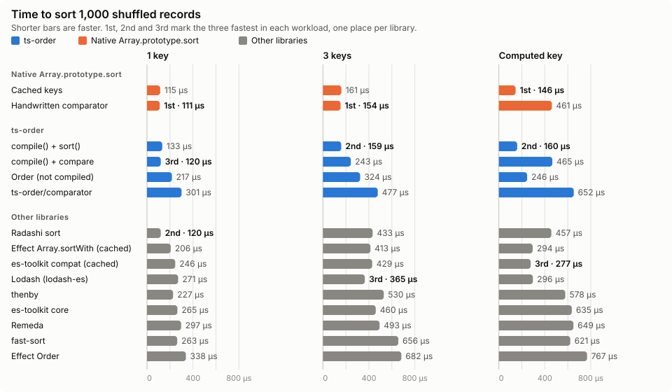
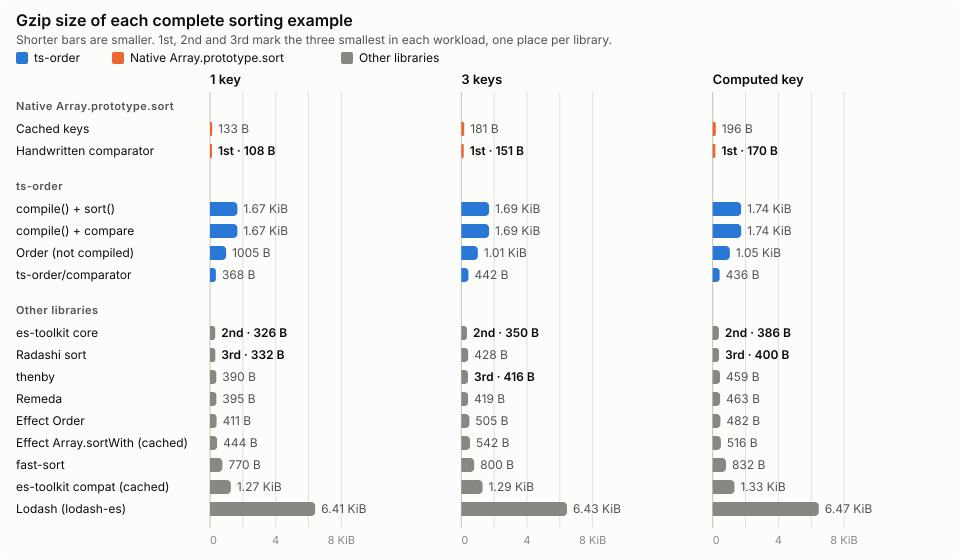

# Sorting benchmarks

## Summary

Time to sort **1,000 shuffled records**, a typical list or table. Lower is faster. **(2.0×)** means the sort takes twice as long as compiled ts-order `sort()`. 🥇🥈🥉 mark the three fastest in each column. Each library, and native code, wins at most one medal, with its fastest entry.



| | 1 key | 3 keys | Computed key |
| --- | ---: | ---: | ---: |
| **Native `Array.prototype.sort`** |  |  |  |
| Cached keys | 115 µs (0.9×) | 161 µs (1.0×) | 🥇 146 µs (0.9×) |
| Handwritten comparator | 🥇 111 µs (0.8×) | 🥇 154 µs (1.0×) | 461 µs (2.9×) |
| **ts-order** |  |  |  |
| `compile()` + `sort()` | 133 µs (1.0×) | 🥈 159 µs (1.0×) | 🥈 160 µs (1.0×) |
| `compile()` + `compare` | 🥉 120 µs (0.9×) | 243 µs (1.5×)† | 465 µs (2.9×) |
| `Order` (not compiled) | 217 µs (1.6×) | 324 µs (2.0×) | 246 µs (1.5×) |
| `ts-order/comparator` | 301 µs (2.3×) | 477 µs (3.0×) | 652 µs (4.1×) |
| **Other libraries** |  |  |  |
| Radashi sort | 🥈 120 µs (0.9×) | 433 µs (2.7×) | 457 µs (2.9×) |
| Effect Array.sortWith (cached) | 206 µs (1.6×) | 413 µs (2.6×) | 294 µs (1.8×) |
| es-toolkit compat (cached) | 246 µs (1.9×) | 429 µs (2.7×) | 🥉 277 µs (1.7×) |
| Lodash (lodash-es) | 271 µs (2.0×) | 🥉 365 µs (2.3×) | 296 µs (1.9×) |
| thenby | 227 µs (1.7×) | 530 µs (3.3×) | 578 µs (3.6×) |
| es-toolkit core | 265 µs (2.0×) | 460 µs (2.9×) | 635 µs (4.0×) |
| Remeda | 297 µs (2.2×) | 493 µs (3.1×) | 649 µs (4.1×) |
| fast-sort | 263 µs (2.0×) | 656 µs (4.1×) | 621 µs (3.9×) |
| Effect Order | 338 µs (2.5×) | 682 µs (4.3×) | 767 µs (4.8×) |

- **1 key:** stored order total, ascending.
- **3 keys:** fulfillment queue: status ↑, newest first, customer surname ↑.
- **Computed key:** computed line-item total after discounts, descending.
- **†:** more than 20% variation between rounds. Treat close results in that cell with caution.

<details>
<summary>10 records</summary>

| | 1 key | 3 keys | Computed key |
| --- | ---: | ---: | ---: |
| **Native `Array.prototype.sort`** |  |  |  |
| Cached keys | 0.399 µs (1.0×) | 0.407 µs (1.0×) | 🥇 0.508 µs (1.0×) |
| Handwritten comparator | 🥇 0.289 µs (0.7×) | 🥈 0.331 µs (0.8×) | 1.02 µs (1.9×) |
| **ts-order** |  |  |  |
| `compile()` + `sort()` | 0.388 µs (1.0×) | 0.428 µs (1.0×) | 🥈 0.531 µs (1.0×) |
| `compile()` + `compare` | 🥈 0.298 µs (0.8×) | 🥇 0.319 µs (0.7×) | 1 µs (1.9×) |
| `Order` (not compiled) | 0.594 µs (1.5×)† | 1.04 µs (2.4×) | 0.862 µs (1.6×) |
| `ts-order/comparator` | 1.01 µs (2.6×)† | 1.21 µs (2.8×) | 1.47 µs (2.8×) |
| **Other libraries** |  |  |  |
| Radashi sort | 🥉 0.4 µs (1.0×) | 🥉 0.584 µs (1.4×)† | 1.38 µs (2.6×)† |
| Effect Array.sortWith (cached) | 0.547 µs (1.4×) | 1.09 µs (2.5×) | 1.03 µs (1.9×) |
| thenby | 0.468 µs (1.2×)† | 1.09 µs (2.5×) | 1.24 µs (2.3×) |
| es-toolkit core | 0.618 µs (1.6×)† | 0.997 µs (2.3×) | 1.38 µs (2.6×) |
| Remeda | 0.572 µs (1.5×)† | 1.07 µs (2.5×) | 1.41 µs (2.7×) |
| Lodash (lodash-es) | 1.04 µs (2.7×)† | 1.33 µs (3.1×) | 1.15 µs (2.2×) |
| es-toolkit compat (cached) | 0.835 µs (2.2×) | 1.98 µs (4.6×) | 🥉 1.02 µs (1.9×) |
| fast-sort | 0.64 µs (1.6×)† | 1.99 µs (4.6×) | 1.57 µs (3.0×) |
| Effect Order | 0.707 µs (1.8×)† | 1.6 µs (3.7×) | 1.79 µs (3.4×) |

</details>

<details>
<summary>100 records</summary>

| | 1 key | 3 keys | Computed key |
| --- | ---: | ---: | ---: |
| **Native `Array.prototype.sort`** |  |  |  |
| Cached keys | 5.99 µs (0.9×) | 6.88 µs (0.7×) | 🥇 7.2 µs (0.9×) |
| Handwritten comparator | 🥇 5.26 µs (0.8×) | 🥇 6.01 µs (0.6×) | 21.7 µs (2.7×) |
| **ts-order** |  |  |  |
| `compile()` + `sort()` | 6.87 µs (1.0×) | 10.1 µs (1.0×)† | 🥈 7.93 µs (1.0×) |
| `compile()` + `compare` | 🥉 5.87 µs (0.9×) | 🥈 6.7 µs (0.7×)† | 21.7 µs (2.7×) |
| `Order` (not compiled) | 13.3 µs (1.9×) | 20.4 µs (2.0×) | 15.1 µs (1.9×) |
| `ts-order/comparator` | 18.5 µs (2.7×) | 27.9 µs (2.8×) | 34.4 µs (4.3×) |
| **Other libraries** |  |  |  |
| Radashi sort | 🥈 5.84 µs (0.9×) | 🥉 23.2 µs (2.3×) | 21.7 µs (2.7×) |
| Effect Array.sortWith (cached) | 12.7 µs (1.8×) | 28.6 µs (2.8×) | 18.3 µs (2.3×) |
| es-toolkit compat (cached) | 15.7 µs (2.3×) | 28.2 µs (2.8×) | 🥉 17.5 µs (2.2×) |
| Lodash (lodash-es) | 17.7 µs (2.6×) | 23.5 µs (2.3×) | 19.1 µs (2.4×) |
| es-toolkit core | 15.9 µs (2.3×) | 25.7 µs (2.5×) | 31.8 µs (4.0×) |
| thenby | 13.1 µs (1.9×) | 35.5 µs (3.5×) | 29 µs (3.7×) |
| Remeda | 19.2 µs (2.8×) | 27.3 µs (2.7×) | 33.7 µs (4.3×) |
| fast-sort | 17 µs (2.5×) | 37.6 µs (3.7×) | 32.3 µs (4.1×) |
| Effect Order | 21.3 µs (3.1×) | 39.3 µs (3.9×) | 42.4 µs (5.3×) |

</details>

<details>
<summary>10,000 records</summary>

| | 1 key | 3 keys | Computed key |
| --- | ---: | ---: | ---: |
| **Native `Array.prototype.sort`** |  |  |  |
| Cached keys | 1.67 ms (0.9×) | 🥈 2.49 ms (1.0×) | 🥇 2.21 ms (0.9×) |
| Handwritten comparator | 🥇 1.66 ms (0.9×) | 2.57 ms (1.1×) | 7.42 ms (3.1×) |
| **ts-order** |  |  |  |
| `compile()` + `sort()` | 🥉 1.87 ms (1.0×) | 🥇 2.43 ms (1.0×) | 🥈 2.36 ms (1.0×) |
| `compile()` + `compare` | 1.9 ms (1.0×) | 2.8 ms (1.2×) | 7.39 ms (3.1×) |
| `Order` (not compiled) | 2.93 ms (1.6×) | 4.79 ms (2.0×) | 3.49 ms (1.5×) |
| `ts-order/comparator` | 4.66 ms (2.5×) | 7.76 ms (3.2×) | 10.8 ms (4.6×) |
| **Other libraries** |  |  |  |
| Effect Array.sortWith (cached) | 3.03 ms (1.6×) | 6 ms (2.5×) | 4.29 ms (1.8×) |
| es-toolkit compat (cached) | 3.45 ms (1.8×) | 6.13 ms (2.5×) | 🥉 4.21 ms (1.8×) |
| Radashi sort | 🥈 1.8 ms (1.0×) | 6.72 ms (2.8×) | 7.41 ms (3.1×) |
| Lodash (lodash-es) | 3.9 ms (2.1×) | 🥉 5.42 ms (2.2×) | 4.54 ms (1.9×) |
| thenby | 3.19 ms (1.7×) | 8.29 ms (3.4×) | 9.57 ms (4.0×) |
| es-toolkit core | 3.82 ms (2.0×) | 7.26 ms (3.0×) | 10.1 ms (4.3×) |
| Remeda | 4.05 ms (2.2×) | 8.08 ms (3.3×) | 10.3 ms (4.3×) |
| fast-sort | 3.79 ms (2.0×) | 10.7 ms (4.4×) | 9.93 ms (4.2×) |
| Effect Order | 4.78 ms (2.6×) | 10.5 ms (4.3×) | 12.3 ms (5.2×) |

</details>

<details>
<summary>100,000 records</summary>

| | 1 key | 3 keys | Computed key |
| --- | ---: | ---: | ---: |
| **Native `Array.prototype.sort`** |  |  |  |
| Cached keys | 31.8 ms (1.3×) | 🥈 45.9 ms (1.3×) | 🥈 52 ms (1.1×)† |
| Handwritten comparator | 🥈 31.6 ms (1.3×)† | 59.1 ms (1.7×) | 205 ms (4.4×) |
| **ts-order** |  |  |  |
| `compile()` + `sort()` | 🥇 25.1 ms (1.0×) | 🥇 34.3 ms (1.0×) | 🥇 46.9 ms (1.0×) |
| `compile()` + `compare` | 34.9 ms (1.4×)† | 75.2 ms (2.2×)† | 207 ms (4.4×) |
| `Order` (not compiled) | 40.9 ms (1.6×) | 74.5 ms (2.2×) | 63.8 ms (1.4×) |
| `ts-order/comparator` | 71 ms (2.8×) | 139 ms (4.1×) | 256 ms (5.5×) |
| **Other libraries** |  |  |  |
| Effect Array.sortWith (cached) | 45.2 ms (1.8×) | 🥉 96.3 ms (2.8×) | 🥉 74 ms (1.6×) |
| Lodash (lodash-es) | 66 ms (2.6×) | 103 ms (3.0×) | 93.2 ms (2.0×) |
| es-toolkit compat (cached) | 64.1 ms (2.6×) | 117 ms (3.4×) | 87.5 ms (1.9×) |
| Radashi sort | 🥉 34.5 ms (1.4×) | 141 ms (4.1×) | 210 ms (4.5×) |
| thenby | 54.6 ms (2.2×) | 159 ms (4.6×) | 238 ms (5.1×) |
| es-toolkit core | 69.9 ms (2.8×)† | 146 ms (4.3×) | 241 ms (5.1×) |
| fast-sort | 62.5 ms (2.5×) | 193 ms (5.6×) | 265 ms (5.6×)† |
| Remeda | 74.1 ms (3.0×) | 159 ms (4.7×) | 294 ms (6.3×) |
| Effect Order | 79.6 ms (3.2×) | 183 ms (5.4×) | 277 ms (5.9×) |

</details>

[Interactive ranked charts](BENCHMARKS.html) · [Historical exhaustive run, before review fixes](benchmarks/full.md)

Measured sizes: **10, 100, 1,000, 10,000, 100,000** records · 2 rounds · shuffled input.

**Short profile:** lower sampling budgets. Use for iteration, not definitive performance claims.

## Runtime results

The code behind every row is listed under [Sorting code](#sorting-code).

Same format as the summary: time per sort, then the time relative to compiled ts-order `sort()`. 🥇🥈🥉 mark the three fastest in each column, one medal per library. Expand the variation table before you trust a close result.

### Stored order total, ascending

#### shuffled

| | 10 | 100 | 1,000 | 10,000 | 100,000 |
| --- | ---: | ---: | ---: | ---: | ---: |
| **Native `Array.prototype.sort`** |  |  |  |  |  |
| Cached keys | 0.399 µs (1.0×) | 5.99 µs (0.9×) | 115 µs (0.9×) | 1.67 ms (0.9×) | 31.8 ms (1.3×) |
| Handwritten comparator | 🥇 0.289 µs (0.7×) | 🥇 5.26 µs (0.8×) | 🥇 111 µs (0.8×) | 🥇 1.66 ms (0.9×) | 🥈 31.6 ms (1.3×)† |
| **ts-order** |  |  |  |  |  |
| `compile()` + `sort()` | 0.388 µs (1.0×) | 6.87 µs (1.0×) | 133 µs (1.0×) | 🥉 1.87 ms (1.0×) | 🥇 25.1 ms (1.0×) |
| `compile()` + `compare` | 🥈 0.298 µs (0.8×) | 🥉 5.87 µs (0.9×) | 🥉 120 µs (0.9×) | 1.9 ms (1.0×) | 34.9 ms (1.4×)† |
| `Order` (not compiled) | 0.594 µs (1.5×)† | 13.3 µs (1.9×) | 217 µs (1.6×) | 2.93 ms (1.6×) | 40.9 ms (1.6×) |
| `ts-order/comparator` | 1.01 µs (2.6×)† | 18.5 µs (2.7×) | 301 µs (2.3×) | 4.66 ms (2.5×) | 71 ms (2.8×) |
| **Other libraries** |  |  |  |  |  |
| Radashi sort | 🥉 0.4 µs (1.0×) | 🥈 5.84 µs (0.9×) | 🥈 120 µs (0.9×) | 🥈 1.8 ms (1.0×) | 🥉 34.5 ms (1.4×) |
| Effect Array.sortWith (cached) | 0.547 µs (1.4×) | 12.7 µs (1.8×) | 206 µs (1.6×) | 3.03 ms (1.6×) | 45.2 ms (1.8×) |
| thenby | 0.468 µs (1.2×)† | 13.1 µs (1.9×) | 227 µs (1.7×) | 3.19 ms (1.7×) | 54.6 ms (2.2×) |
| fast-sort | 0.64 µs (1.6×)† | 17 µs (2.5×) | 263 µs (2.0×) | 3.79 ms (2.0×) | 62.5 ms (2.5×) |
| es-toolkit core | 0.618 µs (1.6×)† | 15.9 µs (2.3×) | 265 µs (2.0×) | 3.82 ms (2.0×) | 69.9 ms (2.8×)† |
| es-toolkit compat (cached) | 0.835 µs (2.2×) | 15.7 µs (2.3×) | 246 µs (1.9×) | 3.45 ms (1.8×) | 64.1 ms (2.6×) |
| Remeda | 0.572 µs (1.5×)† | 19.2 µs (2.8×) | 297 µs (2.2×) | 4.05 ms (2.2×) | 74.1 ms (3.0×) |
| Lodash (lodash-es) | 1.04 µs (2.7×)† | 17.7 µs (2.6×) | 271 µs (2.0×) | 3.9 ms (2.1×) | 66 ms (2.6×) |
| Effect Order | 0.707 µs (1.8×)† | 21.3 µs (3.1×) | 338 µs (2.5×) | 4.78 ms (2.6×) | 79.6 ms (3.2×) |

<details>
<summary>Round-to-round variation (not confidence intervals)</summary>

| Implementation | 10 | 100 | 1,000 | 10,000 | 100,000 |
| --- | ---: | ---: | ---: | ---: | ---: |
| **Native `Array.prototype.sort`** |  |  |  |  |  |
| Cached keys | ±2% | ±2% | ±0% | ±1% | ±12% |
| Handwritten comparator | ±4% | ±0% | ±0% | ±3% | ±21% |
| **ts-order** |  |  |  |  |  |
| `compile()` + `sort()` | ±9% | ±1% | ±1% | ±1% | ±1% |
| `compile()` + `compare` | ±1% | ±1% | ±0% | ±7% | ±21% |
| `Order` (not compiled) | ±24% | ±4% | ±1% | ±2% | ±0% |
| `ts-order/comparator` | ±41% | ±3% | ±0% | ±12% | ±14% |
| **Other libraries** |  |  |  |  |  |
| Radashi sort | ±14% | ±1% | ±1% | ±5% | ±17% |
| Effect Array.sortWith (cached) | ±19% | ±0% | ±1% | ±7% | ±11% |
| thenby | ±35% | ±4% | ±1% | ±2% | ±10% |
| fast-sort | ±44% | ±0% | ±3% | ±8% | ±10% |
| es-toolkit core | ±24% | ±3% | ±0% | ±2% | ±24% |
| es-toolkit compat (cached) | ±18% | ±3% | ±0% | ±4% | ±10% |
| Remeda | ±44% | ±4% | ±4% | ±4% | ±2% |
| Lodash (lodash-es) | ±28% | ±0% | ±1% | ±5% | ±1% |
| Effect Order | ±44% | ±1% | ±1% | ±3% | ±10% |

</details>

### Fulfillment queue: status ↑, newest first, customer surname ↑

#### shuffled

| | 10 | 100 | 1,000 | 10,000 | 100,000 |
| --- | ---: | ---: | ---: | ---: | ---: |
| **Native `Array.prototype.sort`** |  |  |  |  |  |
| Cached keys | 0.407 µs (1.0×) | 6.88 µs (0.7×) | 161 µs (1.0×) | 🥈 2.49 ms (1.0×) | 🥈 45.9 ms (1.3×) |
| Handwritten comparator | 🥈 0.331 µs (0.8×) | 🥇 6.01 µs (0.6×) | 🥇 154 µs (1.0×) | 2.57 ms (1.1×) | 59.1 ms (1.7×) |
| **ts-order** |  |  |  |  |  |
| `compile()` + `sort()` | 0.428 µs (1.0×) | 10.1 µs (1.0×)† | 🥈 159 µs (1.0×) | 🥇 2.43 ms (1.0×) | 🥇 34.3 ms (1.0×) |
| `compile()` + `compare` | 🥇 0.319 µs (0.7×) | 🥈 6.7 µs (0.7×)† | 243 µs (1.5×)† | 2.8 ms (1.2×) | 75.2 ms (2.2×)† |
| `Order` (not compiled) | 1.04 µs (2.4×) | 20.4 µs (2.0×) | 324 µs (2.0×) | 4.79 ms (2.0×) | 74.5 ms (2.2×) |
| `ts-order/comparator` | 1.21 µs (2.8×) | 27.9 µs (2.8×) | 477 µs (3.0×) | 7.76 ms (3.2×) | 139 ms (4.1×) |
| **Other libraries** |  |  |  |  |  |
| Radashi sort | 🥉 0.584 µs (1.4×)† | 🥉 23.2 µs (2.3×) | 433 µs (2.7×) | 6.72 ms (2.8×) | 141 ms (4.1×) |
| Lodash (lodash-es) | 1.33 µs (3.1×) | 23.5 µs (2.3×) | 🥉 365 µs (2.3×) | 🥉 5.42 ms (2.2×) | 103 ms (3.0×) |
| Effect Array.sortWith (cached) | 1.09 µs (2.5×) | 28.6 µs (2.8×) | 413 µs (2.6×) | 6 ms (2.5×) | 🥉 96.3 ms (2.8×) |
| es-toolkit core | 0.997 µs (2.3×) | 25.7 µs (2.5×) | 460 µs (2.9×) | 7.26 ms (3.0×) | 146 ms (4.3×) |
| es-toolkit compat (cached) | 1.98 µs (4.6×) | 28.2 µs (2.8×) | 429 µs (2.7×) | 6.13 ms (2.5×) | 117 ms (3.4×) |
| Remeda | 1.07 µs (2.5×) | 27.3 µs (2.7×) | 493 µs (3.1×) | 8.08 ms (3.3×) | 159 ms (4.7×) |
| thenby | 1.09 µs (2.5×) | 35.5 µs (3.5×) | 530 µs (3.3×) | 8.29 ms (3.4×) | 159 ms (4.6×) |
| Effect Order | 1.6 µs (3.7×) | 39.3 µs (3.9×) | 682 µs (4.3×) | 10.5 ms (4.3×) | 183 ms (5.4×) |
| fast-sort | 1.99 µs (4.6×) | 37.6 µs (3.7×) | 656 µs (4.1×) | 10.7 ms (4.4×) | 193 ms (5.6×) |

<details>
<summary>Round-to-round variation (not confidence intervals)</summary>

| Implementation | 10 | 100 | 1,000 | 10,000 | 100,000 |
| --- | ---: | ---: | ---: | ---: | ---: |
| **Native `Array.prototype.sort`** |  |  |  |  |  |
| Cached keys | ±3% | ±4% | ±0% | ±2% | ±3% |
| Handwritten comparator | ±4% | ±4% | ±1% | ±2% | ±5% |
| **ts-order** |  |  |  |  |  |
| `compile()` + `sort()` | ±1% | ±31% | ±0% | ±0% | ±1% |
| `compile()` + `compare` | ±0% | ±22% | ±36% | ±4% | ±21% |
| `Order` (not compiled) | ±1% | ±9% | ±1% | ±3% | ±7% |
| `ts-order/comparator` | ±12% | ±3% | ±0% | ±2% | ±4% |
| **Other libraries** |  |  |  |  |  |
| Radashi sort | ±35% | ±4% | ±4% | ±2% | ±5% |
| Lodash (lodash-es) | ±4% | ±6% | ±2% | ±2% | ±0% |
| Effect Array.sortWith (cached) | ±4% | ±16% | ±0% | ±3% | ±3% |
| es-toolkit core | ±4% | ±2% | ±1% | ±1% | ±0% |
| es-toolkit compat (cached) | ±1% | ±0% | ±1% | ±3% | ±3% |
| Remeda | ±8% | ±4% | ±0% | ±4% | ±0% |
| thenby | ±4% | ±19% | ±1% | ±5% | ±2% |
| Effect Order | ±4% | ±3% | ±0% | ±1% | ±2% |
| fast-sort | ±5% | ±3% | ±2% | ±3% | ±2% |

</details>

### Computed line-item total after discounts, descending

#### shuffled

| | 10 | 100 | 1,000 | 10,000 | 100,000 |
| --- | ---: | ---: | ---: | ---: | ---: |
| **Native `Array.prototype.sort`** |  |  |  |  |  |
| Cached keys | 🥇 0.508 µs (1.0×) | 🥇 7.2 µs (0.9×) | 🥇 146 µs (0.9×) | 🥇 2.21 ms (0.9×) | 🥈 52 ms (1.1×)† |
| Handwritten comparator | 1.02 µs (1.9×) | 21.7 µs (2.7×) | 461 µs (2.9×) | 7.42 ms (3.1×) | 205 ms (4.4×) |
| **ts-order** |  |  |  |  |  |
| `compile()` + `sort()` | 🥈 0.531 µs (1.0×) | 🥈 7.93 µs (1.0×) | 🥈 160 µs (1.0×) | 🥈 2.36 ms (1.0×) | 🥇 46.9 ms (1.0×) |
| `compile()` + `compare` | 1 µs (1.9×) | 21.7 µs (2.7×) | 465 µs (2.9×) | 7.39 ms (3.1×) | 207 ms (4.4×) |
| `Order` (not compiled) | 0.862 µs (1.6×) | 15.1 µs (1.9×) | 246 µs (1.5×) | 3.49 ms (1.5×) | 63.8 ms (1.4×) |
| `ts-order/comparator` | 1.47 µs (2.8×) | 34.4 µs (4.3×) | 652 µs (4.1×) | 10.8 ms (4.6×) | 256 ms (5.5×) |
| **Other libraries** |  |  |  |  |  |
| Effect Array.sortWith (cached) | 1.03 µs (1.9×) | 18.3 µs (2.3×) | 294 µs (1.8×) | 4.29 ms (1.8×) | 🥉 74 ms (1.6×) |
| es-toolkit compat (cached) | 🥉 1.02 µs (1.9×) | 🥉 17.5 µs (2.2×) | 🥉 277 µs (1.7×) | 🥉 4.21 ms (1.8×) | 87.5 ms (1.9×) |
| Lodash (lodash-es) | 1.15 µs (2.2×) | 19.1 µs (2.4×) | 296 µs (1.9×) | 4.54 ms (1.9×) | 93.2 ms (2.0×) |
| Radashi sort | 1.38 µs (2.6×)† | 21.7 µs (2.7×) | 457 µs (2.9×) | 7.41 ms (3.1×) | 210 ms (4.5×) |
| thenby | 1.24 µs (2.3×) | 29 µs (3.7×) | 578 µs (3.6×) | 9.57 ms (4.0×) | 238 ms (5.1×) |
| es-toolkit core | 1.38 µs (2.6×) | 31.8 µs (4.0×) | 635 µs (4.0×) | 10.1 ms (4.3×) | 241 ms (5.1×) |
| fast-sort | 1.57 µs (3.0×) | 32.3 µs (4.1×) | 621 µs (3.9×) | 9.93 ms (4.2×) | 265 ms (5.6×)† |
| Remeda | 1.41 µs (2.7×) | 33.7 µs (4.3×) | 649 µs (4.1×) | 10.3 ms (4.3×) | 294 ms (6.3×) |
| Effect Order | 1.79 µs (3.4×) | 42.4 µs (5.3×) | 767 µs (4.8×) | 12.3 ms (5.2×) | 277 ms (5.9×) |

<details>
<summary>Round-to-round variation (not confidence intervals)</summary>

| Implementation | 10 | 100 | 1,000 | 10,000 | 100,000 |
| --- | ---: | ---: | ---: | ---: | ---: |
| **Native `Array.prototype.sort`** |  |  |  |  |  |
| Cached keys | ±2% | ±0% | ±2% | ±9% | ±25% |
| Handwritten comparator | ±2% | ±3% | ±3% | ±3% | ±19% |
| **ts-order** |  |  |  |  |  |
| `compile()` + `sort()` | ±0% | ±1% | ±2% | ±4% | ±12% |
| `compile()` + `compare` | ±2% | ±3% | ±1% | ±2% | ±13% |
| `Order` (not compiled) | ±3% | ±1% | ±3% | ±7% | ±16% |
| `ts-order/comparator` | ±6% | ±1% | ±1% | ±8% | ±19% |
| **Other libraries** |  |  |  |  |  |
| Effect Array.sortWith (cached) | ±2% | ±0% | ±1% | ±2% | ±12% |
| es-toolkit compat (cached) | ±2% | ±1% | ±2% | ±3% | ±9% |
| Lodash (lodash-es) | ±0% | ±1% | ±1% | ±6% | ±11% |
| Radashi sort | ±26% | ±3% | ±2% | ±1% | ±20% |
| thenby | ±5% | ±3% | ±2% | ±7% | ±19% |
| es-toolkit core | ±1% | ±1% | ±0% | ±1% | ±18% |
| fast-sort | ±7% | ±4% | ±3% | ±5% | ±23% |
| Remeda | ±5% | ±1% | ±0% | ±4% | ±2% |
| Effect Order | ±5% | ±1% | ±1% | ±6% | ±18% |

</details>

## Bundle overhead

Each result is a **complete working sorting example**, not an npm install size or the whole library. The same code used for timing is bundled individually for each workload. The native baseline contains the equivalent handwritten comparator. Each emitted bundle is executed and checked against the same reference before its size is accepted.

esbuild bundles for browser ESM / ES2022 with minification, tree shaking and legal comments removed; gzip uses level 9. No source maps, external packages, runtime polyfills, data fixtures or benchmark runner are included. ts-order resolves to its built public exports. Application glue and selector code are included; native rows show the no-library cost. Each example is written for its workload, with the selectors inline, as an application would write it. The code is listed under **Sorting code**.



Each cell is the **gzip size** of the whole example, then in brackets the extra gzip over the no-library handwritten example. 🥇🥈🥉 mark the three smallest in each column, one medal per library. B = bytes; KiB = 1,024 bytes. Deltas are example overhead, not context-independent library sizes: compression and shared application code are non-additive.

| | 1 key | 3 keys | Computed key |
| --- | ---: | ---: | ---: |
| **Native `Array.prototype.sort`** |  |  |  |
| Cached keys | 133 B (+25 B) | 181 B (+30 B) | 196 B (+26 B) |
| Handwritten comparator | 🥇 108 B (0 B) | 🥇 151 B (0 B) | 🥇 170 B (0 B) |
| **ts-order** |  |  |  |
| `compile()` + `sort()` | 1.67 KiB (+1.56 KiB) | 1.69 KiB (+1.54 KiB) | 1.74 KiB (+1.57 KiB) |
| `compile()` + `compare` | 1.67 KiB (+1.56 KiB) | 1.69 KiB (+1.54 KiB) | 1.74 KiB (+1.57 KiB) |
| `Order` (not compiled) | 1005 B (+897 B) | 1.01 KiB (+880 B) | 1.05 KiB (+903 B) |
| `ts-order/comparator` | 368 B (+260 B) | 442 B (+291 B) | 436 B (+266 B) |
| **Other libraries** |  |  |  |
| es-toolkit core | 🥈 326 B (+218 B) | 🥈 350 B (+199 B) | 🥈 386 B (+216 B) |
| Radashi sort | 🥉 332 B (+224 B) | 428 B (+277 B) | 🥉 400 B (+230 B) |
| thenby | 390 B (+282 B) | 🥉 416 B (+265 B) | 459 B (+289 B) |
| Remeda | 395 B (+287 B) | 419 B (+268 B) | 463 B (+293 B) |
| Effect Order | 411 B (+303 B) | 505 B (+354 B) | 482 B (+312 B) |
| Effect Array.sortWith (cached) | 444 B (+336 B) | 542 B (+391 B) | 516 B (+346 B) |
| fast-sort | 770 B (+662 B) | 800 B (+649 B) | 832 B (+662 B) |
| es-toolkit compat (cached) | 1.27 KiB (+1.16 KiB) | 1.29 KiB (+1.15 KiB) | 1.33 KiB (+1.16 KiB) |
| Lodash (lodash-es) | 6.41 KiB (+6.30 KiB) | 6.43 KiB (+6.29 KiB) | 6.47 KiB (+6.30 KiB) |

<details>
<summary>Minified sizes, before gzip</summary>

| | 1 key | 3 keys | Computed key |
| --- | ---: | ---: | ---: |
| **Native `Array.prototype.sort`** |  |  |  |
| Cached keys | 138 B | 273 B | 242 B |
| Handwritten comparator | 103 B | 210 B | 199 B |
| **ts-order** |  |  |  |
| `compile()` + `sort()` | 4.09 KiB | 4.15 KiB | 4.20 KiB |
| `compile()` + `compare` | 4.09 KiB | 4.15 KiB | 4.21 KiB |
| `Order` (not compiled) | 2.26 KiB | 2.32 KiB | 2.37 KiB |
| `ts-order/comparator` | 607 B | 768 B | 724 B |
| **Other libraries** |  |  |  |
| es-toolkit core | 491 B | 538 B | 590 B |
| Radashi sort | 570 B | 740 B | 675 B |
| thenby | 695 B | 752 B | 800 B |
| Remeda | 671 B | 714 B | 778 B |
| Effect Order | 840 B | 1.04 KiB | 979 B |
| Effect Array.sortWith (cached) | 902 B | 1.09 KiB | 1.02 KiB |
| fast-sort | 1.61 KiB | 1.66 KiB | 1.70 KiB |
| es-toolkit compat (cached) | 2.72 KiB | 2.76 KiB | 2.82 KiB |
| Lodash (lodash-es) | 16.81 KiB | 16.86 KiB | 16.91 KiB |

</details>

## Sorting code

The exact code that was timed and bundled, for every implementation and workload. Each module in `benchmarks/adapters/` exports one function per workload. That function runs once, before timing, to prepare any reusable definition. The function it returns is the one timed. Imports of the shared `Purchase` type, `Sorter` type and `computedTotal` helper from `benchmarks/cases.ts` are left out; `computedTotal` sums the discounted line items, rounding each line to cents.

### Stored order total, ascending

#### Native handwritten

```ts
export function total(): Sorter {
	return (purchases) =>
		purchases.toSorted((a, b) => a.totalCents - b.totalCents);
}
```

#### Native cached keys

```ts
export function total(): Sorter {
	return (purchases) =>
		purchases
			.map((value) => ({ value, key: value.totalCents }))
			.sort((a, b) => a.key - b.key)
			.map((entry) => entry.value);
}
```

#### ts-order class

```ts
import { Order } from 'ts-order';

export function total(): Sorter {
	const byTotal = new Order<Purchase>().by((purchase) => purchase.totalCents);
	return (purchases) => byTotal.sort(purchases);
}
```

#### ts-order comparator

```ts
import { by, order } from 'ts-order/comparator';

export function total(): Sorter {
	const compare = by((purchase: Purchase) => purchase.totalCents);
	return (purchases) => purchases.toSorted(compare);
}
```

#### ts-order compiled sort

```ts
import { compile, Order } from 'ts-order';

export function total(): Sorter {
	const byTotal = compile(
		new Order<Purchase>().by((purchase) => purchase.totalCents),
	);
	byTotal.sort([]); // generates the sort code once, before timing
	return (purchases) => byTotal.sort(purchases);
}
```

#### ts-order compiled compare

```ts
import { compile, Order } from 'ts-order';

export function total(): Sorter {
	const { compare } = compile(
		new Order<Purchase>().by((purchase) => purchase.totalCents),
	);
	return (purchases) => purchases.toSorted(compare);
}
```

#### Lodash (lodash-es)

```ts
import { orderBy } from 'lodash-es';

export function total(): Sorter {
	return (purchases) =>
		orderBy(
			purchases,
			[(purchase: Purchase) => purchase.totalCents],
			['asc'],
		);
}
```

#### es-toolkit core

```ts
import { orderBy } from 'es-toolkit/array';

export function total(): Sorter {
	return (purchases) =>
		orderBy(
			purchases,
			[(purchase: Purchase) => purchase.totalCents],
			['asc'],
		);
}
```

#### es-toolkit compat (cached)

```ts
import { orderBy } from 'es-toolkit/compat';

export function total(): Sorter {
	return (purchases) =>
		orderBy(
			purchases,
			[(purchase: Purchase) => purchase.totalCents],
			['asc'],
		);
}
```

#### fast-sort

```ts
import { sort } from 'fast-sort';

export function total(): Sorter {
	return (purchases) =>
		sort(purchases).asc((purchase) => purchase.totalCents);
}
```

#### Remeda

```ts
import { sortBy } from 'remeda';

export function total(): Sorter {
	return sortBy<readonly Purchase[]>((purchase) => purchase.totalCents);
}
```

#### thenby

```ts
import { firstBy } from 'thenby';

export function total(): Sorter {
	const compare = firstBy((purchase: Purchase) => purchase.totalCents);
	return (purchases) => purchases.toSorted(compare);
}
```

#### Effect Order

```ts
import * as Order from 'effect/Order';

export function total(): Sorter {
	const compare = Order.mapInput(
		Order.Number,
		(purchase: Purchase) => purchase.totalCents,
	);
	return (purchases) => purchases.toSorted(compare);
}
```

#### Effect Array.sortWith (cached)

```ts
import * as EffectArray from 'effect/Array';
import * as Order from 'effect/Order';

export function total(): Sorter {
	return EffectArray.sortWith<readonly Purchase[], number>(
		(purchase) => purchase.totalCents,
		Order.Number,
	);
}
```

#### Radashi sort

```ts
import { castComparator, sort } from 'radashi';

export function total(): Sorter {
	return (purchases) => sort(purchases, (purchase) => purchase.totalCents);
}
```

### Fulfillment queue: status ↑, newest first, customer surname ↑

#### Native handwritten

```ts
export function fulfillment(): Sorter {
	return (purchases) =>
		purchases.toSorted(
			(a, b) =>
				a.status - b.status ||
				b.createdAt - a.createdAt ||
				(a.customer.lastName < b.customer.lastName
					? -1
					: a.customer.lastName > b.customer.lastName
						? 1
						: 0),
		);
}
```

#### Native cached keys

```ts
export function fulfillment(): Sorter {
	return (purchases) =>
		purchases
			.map((value) => ({
				value,
				status: value.status,
				createdAt: value.createdAt,
				lastName: value.customer.lastName,
			}))
			.sort(
				(a, b) =>
					a.status - b.status ||
					b.createdAt - a.createdAt ||
					(a.lastName < b.lastName
						? -1
						: a.lastName > b.lastName
							? 1
							: 0),
			)
			.map((entry) => entry.value);
}
```

#### ts-order class

```ts
import { Order } from 'ts-order';

export function fulfillment(): Sorter {
	const queue = new Order<Purchase>()
		.by((purchase) => purchase.status)
		.by((purchase) => purchase.createdAt, { direction: 'desc' })
		.by((purchase) => purchase.customer.lastName);
	return (purchases) => queue.sort(purchases);
}
```

#### ts-order comparator

```ts
import { by, order } from 'ts-order/comparator';

export function fulfillment(): Sorter {
	const compare = order(
		by((purchase: Purchase) => purchase.status),
		by((purchase: Purchase) => purchase.createdAt, { direction: 'desc' }),
		by((purchase: Purchase) => purchase.customer.lastName),
	);
	return (purchases) => purchases.toSorted(compare);
}
```

#### ts-order compiled sort

```ts
import { compile, Order } from 'ts-order';

export function fulfillment(): Sorter {
	const queue = compile(
		new Order<Purchase>()
			.by((purchase) => purchase.status)
			.by((purchase) => purchase.createdAt, { direction: 'desc' })
			.by((purchase) => purchase.customer.lastName),
	);
	queue.sort([]); // generates the sort code once, before timing
	return (purchases) => queue.sort(purchases);
}
```

#### ts-order compiled compare

```ts
import { compile, Order } from 'ts-order';

export function fulfillment(): Sorter {
	const { compare } = compile(
		new Order<Purchase>()
			.by((purchase) => purchase.status)
			.by((purchase) => purchase.createdAt, { direction: 'desc' })
			.by((purchase) => purchase.customer.lastName),
	);
	return (purchases) => purchases.toSorted(compare);
}
```

#### Lodash (lodash-es)

```ts
import { orderBy } from 'lodash-es';

export function fulfillment(): Sorter {
	return (purchases) =>
		orderBy(
			purchases,
			[
				(purchase: Purchase) => purchase.status,
				(purchase: Purchase) => purchase.createdAt,
				(purchase: Purchase) => purchase.customer.lastName,
			],
			['asc', 'desc', 'asc'],
		);
}
```

#### es-toolkit core

```ts
import { orderBy } from 'es-toolkit/array';

export function fulfillment(): Sorter {
	return (purchases) =>
		orderBy(
			purchases,
			[
				(purchase: Purchase) => purchase.status,
				(purchase: Purchase) => purchase.createdAt,
				(purchase: Purchase) => purchase.customer.lastName,
			],
			['asc', 'desc', 'asc'],
		);
}
```

#### es-toolkit compat (cached)

```ts
import { orderBy } from 'es-toolkit/compat';

export function fulfillment(): Sorter {
	return (purchases) =>
		orderBy(
			purchases,
			[
				(purchase: Purchase) => purchase.status,
				(purchase: Purchase) => purchase.createdAt,
				(purchase: Purchase) => purchase.customer.lastName,
			],
			['asc', 'desc', 'asc'],
		);
}
```

#### fast-sort

```ts
import { sort } from 'fast-sort';

export function fulfillment(): Sorter {
	return (purchases) =>
		sort(purchases).by([
			{ asc: (purchase) => purchase.status },
			{ desc: (purchase) => purchase.createdAt },
			{ asc: (purchase) => purchase.customer.lastName },
		]);
}
```

#### Remeda

```ts
import { sortBy } from 'remeda';

export function fulfillment(): Sorter {
	return sortBy<readonly Purchase[]>(
		(purchase) => purchase.status,
		[(purchase) => purchase.createdAt, 'desc'],
		(purchase) => purchase.customer.lastName,
	);
}
```

#### thenby

```ts
import { firstBy } from 'thenby';

export function fulfillment(): Sorter {
	const compare = firstBy((purchase: Purchase) => purchase.status)
		.thenBy((purchase) => purchase.createdAt, 'desc')
		.thenBy((purchase) => purchase.customer.lastName);
	return (purchases) => purchases.toSorted(compare);
}
```

#### Effect Order

```ts
import * as Order from 'effect/Order';

export function fulfillment(): Sorter {
	const compare = Order.combineAll([
		Order.mapInput(Order.Number, (purchase: Purchase) => purchase.status),
		Order.flip(
			Order.mapInput(
				Order.Number,
				(purchase: Purchase) => purchase.createdAt,
			),
		),
		Order.mapInput(
			Order.String,
			(purchase: Purchase) => purchase.customer.lastName,
		),
	]);
	return (purchases) => purchases.toSorted(compare);
}
```

#### Effect Array.sortWith (cached)

```ts
import * as EffectArray from 'effect/Array';
import * as Order from 'effect/Order';

export function fulfillment(): Sorter {
	return EffectArray.sortWith<
		readonly Purchase[],
		readonly [number, number, string]
	>(
		(purchase) => [
			purchase.status,
			purchase.createdAt,
			purchase.customer.lastName,
		],
		Order.Tuple([Order.Number, Order.flip(Order.Number), Order.String]),
	);
}
```

#### Radashi sort

```ts
import { castComparator, sort } from 'radashi';

export function fulfillment(): Sorter {
	const byStatus = castComparator((purchase: Purchase) => purchase.status);
	const byNewest = castComparator(
		(purchase: Purchase) => purchase.createdAt,
		null,
		true,
	);
	const bySurname = castComparator(
		(purchase: Purchase) => purchase.customer.lastName,
	);
	return (purchases) =>
		purchases.toSorted(
			(a, b) => byStatus(a, b) || byNewest(a, b) || bySurname(a, b),
		);
}
```

### Computed line-item total after discounts, descending

#### Native handwritten

```ts
export function computed(): Sorter {
	return (purchases) =>
		purchases.toSorted((a, b) => computedTotal(b) - computedTotal(a));
}
```

#### Native cached keys

```ts
export function computed(): Sorter {
	return (purchases) =>
		purchases
			.map((value) => ({ value, key: computedTotal(value) }))
			.sort((a, b) => b.key - a.key)
			.map((entry) => entry.value);
}
```

#### ts-order class

```ts
import { Order } from 'ts-order';

export function computed(): Sorter {
	const byComputedTotal = new Order<Purchase>().by(computedTotal, {
		direction: 'desc',
	});
	return (purchases) => byComputedTotal.sort(purchases);
}
```

#### ts-order comparator

```ts
import { by, order } from 'ts-order/comparator';

export function computed(): Sorter {
	const compare = by(computedTotal, { direction: 'desc' });
	return (purchases) => purchases.toSorted(compare);
}
```

#### ts-order compiled sort

```ts
import { compile, Order } from 'ts-order';

export function computed(): Sorter {
	const byComputedTotal = compile(
		new Order<Purchase>().by(computedTotal, { direction: 'desc' }),
	);
	byComputedTotal.sort([]); // generates the sort code once, before timing
	return (purchases) => byComputedTotal.sort(purchases);
}
```

#### ts-order compiled compare

```ts
import { compile, Order } from 'ts-order';

export function computed(): Sorter {
	const { compare } = compile(
		new Order<Purchase>().by(computedTotal, { direction: 'desc' }),
	);
	return (purchases) => purchases.toSorted(compare);
}
```

#### Lodash (lodash-es)

```ts
import { orderBy } from 'lodash-es';

export function computed(): Sorter {
	return (purchases) => orderBy(purchases, [computedTotal], ['desc']);
}
```

#### es-toolkit core

```ts
import { orderBy } from 'es-toolkit/array';

export function computed(): Sorter {
	return (purchases) => orderBy(purchases, [computedTotal], ['desc']);
}
```

#### es-toolkit compat (cached)

```ts
import { orderBy } from 'es-toolkit/compat';

export function computed(): Sorter {
	return (purchases) => orderBy(purchases, [computedTotal], ['desc']);
}
```

#### fast-sort

```ts
import { sort } from 'fast-sort';

export function computed(): Sorter {
	return (purchases) => sort(purchases).desc(computedTotal);
}
```

#### Remeda

```ts
import { sortBy } from 'remeda';

export function computed(): Sorter {
	return sortBy<readonly Purchase[]>([computedTotal, 'desc']);
}
```

#### thenby

```ts
import { firstBy } from 'thenby';

export function computed(): Sorter {
	const compare = firstBy(computedTotal, 'desc');
	return (purchases) => purchases.toSorted(compare);
}
```

#### Effect Order

```ts
import * as Order from 'effect/Order';

export function computed(): Sorter {
	const compare = Order.flip(Order.mapInput(Order.Number, computedTotal));
	return (purchases) => purchases.toSorted(compare);
}
```

#### Effect Array.sortWith (cached)

```ts
import * as EffectArray from 'effect/Array';
import * as Order from 'effect/Order';

export function computed(): Sorter {
	return EffectArray.sortWith<readonly Purchase[], number>(
		computedTotal,
		Order.flip(Order.Number),
	);
}
```

#### Radashi sort

```ts
import { castComparator, sort } from 'radashi';

export function computed(): Sorter {
	return (purchases) => sort(purchases, computedTotal, 'desc');
}
```

<details>
<summary>Methodology, reproduction commands and environment</summary>

## Reproduce

```sh
bun install --frozen-lockfile
bun run bench:check    # types, fixtures, adapter correctness and bundle smoke tests
bun run bench          # short profile; writes BENCHMARKS.md, BENCHMARKS.html and benchmarks/results.json
bun run bench:full     # exhaustive profile; writes benchmarks/full.md, full.html and full.json
bun run bench:sizes    # bundle-only measurements; writes benchmarks/sizes.json
```

Bun installs dependencies and launches scripts; timings run on **Node through tsx**, not Bun. Close busy applications and repeat measurements in fresh processes. Commit the lockfile, source and generated results together. Both profiles include 10, 100, 1,000, 10,000 and 100,000 records. The short profile uses shuffled input, two rounds, 50 ms measurement and 20 ms warmup budgets with at least three samples. The 100,000-record cases dominate its runtime; expect roughly one to two minutes on a laptop, depending on hardware. The exhaustive profile adds all four input shapes with larger sampling budgets; it can take 10–15 minutes on a laptop. There are no timing thresholds in CI.

## Workloads and inputs

An e-commerce order dashboard is the shared use case. Each record has a customer, fulfillment status, creation timestamp, stored total and 1–12 line items. Money is integer cents; each line applies its percentage discount and rounds to cents before totals are summed.

- **Stored total:** one inexpensive numeric key, ascending. Represents clicking a numeric table column.
- **Fulfillment queue:** status rank ascending, creation timestamp descending, then nested customer surname ascending. Five statuses, 180 dates and ten surnames deliberately exercise secondary keys and ties.
- **Computed total:** sum discounted line-item totals on demand, descending. Represents sorting derived values not already indexed or stored. Unlike a synthetic busy loop, this does useful work; an application that already caches this total should use the stored-total results instead.

Arrays of **10, 100, 1,000, 10,000 and 100,000** records span a tiny dropdown/list, a small loaded table, a large table, client-side filtering, and a bulk export/offline workload. This measures sorting the entire loaded array, not server-side pagination or rendering.

The exhaustive profile runs each workload with shuffled, already sorted, reversed and nearly sorted inputs; the short profile uses shuffled input only. Nearly sorted inputs start sorted, then swap 1% of record pairs (up to roughly 2% of positions). Seeded generation and Fisher–Yates shuffling are reproducible. Each round uses a different seed, shared by every implementation. About 5% of records duplicate all sort fields of their predecessor, ensuring stability is tested in the generated arrays of at least 100 records. Separate hand-built fixtures test ties for tiny inputs too. Equal-key results preserve the current input order; no artificial ID tie-breaker is added.

## Fairness and scope

- Every implementation returns a new array and preserves the original records. Copying, key extraction, temporary allocations and ordinary garbage collection are included in timings. Dataset generation, reference sorting, validation, imports and report generation are excluded.
- Implementations that sort through a comparator use the modern non-mutating `Array.prototype.toSorted()`, including the native baseline, so the copy is measured the same way for each of them.
- The handwritten native baseline short-circuits directly on the workload fields. A separate native decorate–sort–undecorate baseline computes keys once per item into a flat object with one field per key. This distinguishes library overhead from the benefits and costs of caching.
- Orders, comparator chains, selectors and rule arrays are prepared once outside timing for **every** implementation that supports reuse. Per-call work imposed by a library API remains timed. This measures repeated sorting with a reused definition, not one-shot construction or module startup.
- ts-order class means `Order.sort()` (cached keys); compiled sort means `compile(order).sort()` with the same keys. The compiled compare row uses `compile(order).compare`. Code generation is completed outside timing. These are steady-state measurements, not compile-time or break-even measurements. ts-order comparator means `by()` directly for one key, or `order()` for multiple keys. They import separate public entry points. ts-order uses the local production build, not the previously published npm version. The runner requires Node with `new Function` available and stops if code generation is blocked. The library itself falls back to normal ordering in such environments; these compiled timings do not predict that fallback’s performance.
- Lodash uses the tree-shakable `lodash-es` ESM distribution, rather than charging for the entire CommonJS library. es-toolkit core and compatibility `orderBy` are separate rows; the compatibility variant caches extracted keys, as Lodash `orderBy` does. es-toolkit core, Remeda, fast-sort, thenby and Radashi call the key functions on every comparison. Effect Order uses its public primitive orders and mapped/composed comparators. A separate Effect `Array.sortWith` variant caches single numeric keys. Neither Effect entry needs an Effect runtime. Existing core/comparator rows are retained rather than silently switching algorithms by workload.
- Every library runs every workload with its own public API. Radashi `sort` takes one numeric key and Radashi has no way to chain comparators, so its fulfillment queue joins one `castComparator` per key with `||`. Effect `Array.sortWith` computes one key per item; its fulfillment queue makes that key a tuple, compared with `Order.Tuple`. Natural sorting, locale collation, missing keys, heterogeneous values, conditional rules and invalid numbers are outside this comparison; they have different semantics across libraries. [benchmarks/complex.md](benchmarks/complex.md) compares ts-order with native comparators on those.
- Correctness checks compare every output object against an independent handwritten reference, including exact tie order, before timing and after each warmup/measurement phase. Tests additionally freeze nested data and cover empty, singleton, tied, negative and zero-valued keys.

## Measurement method

Each cell is the **median of 2 round means**, per complete sort. A column uses **µs** if its fastest entry is below 1 ms, otherwise **ms**; all entries within that column use the same unit. Each cell also shows its time divided by the time of compiled ts-order `sort()`: **2.0×** takes twice as long. A medal marks one of the three lowest observed times, not a proven statistical win. A † flags over 20% round-to-round variation. Exact variation percentages are in the collapsed tables; they are **not confidence intervals**. Raw JSON also records each round’s sample count, mean, median, p99 and Tinybench relative margin of error.

Tinybench runs synchronously and sequentially: at least 50 ms and 3 samples per implementation per cell, preceded by at least 20 ms and three warmup iterations. Implementation order is deterministically shuffled for each group and round. Seeds start at 20261119. No outliers are removed; no forced garbage collection runs between samples.

With only two rounds, the displayed center averages the two round means; the deviation is just their half-range, not a robust uncertainty estimate. Round variation includes dataset differences, JIT state, allocation pressure and machine noise. Rounds share one process: these numbers do not estimate process-to-process uncertainty. Small differences and noisy cells should not be treated as wins. There is intentionally no aggregate score that weights unrelated workloads or hides unfavorable sizes.

## Environment

- Measured: 2026-11-20T12:33:02.618Z
- Node: v24.22.3; V8: 13.6.233.17-node.63
- System: darwin 24.5.0 arm64; CPU: Apple M1 Pro; RAM: 16 GiB
- Base commit: `064cca93ac1baff992f5ee5c76e6f61e50db2097`; working tree dirty: **true**
- Benchmark source SHA-256: `fa54fa0161257c12ae8d18ba76edb1369b2c236c35d4b37deb3851f97fd313f7` (library and benchmark TypeScript, package.json and bun.lock; generated reports excluded)

| Package | Version |
| --- | --- |
| ts-order | 0.0.6 |
| lodash-es | 4.18.1 |
| es-toolkit | 1.53.2 |
| fast-sort | 3.4.1 |
| remeda | 2.60.0 |
| thenby | 1.4.1 |
| effect | 4.1.4 |
| radashi | 13.0.4 |
| tinybench | 6.2.3 |
| esbuild | 0.28.2 |
| tsx | 4.23.15 |

The source hash records the tree at measurement time, not later report-template or CLI-profile edits. Re-rendering a saved result does not rerun its timings.


</details>


## Limits

These are deterministic synthetic orders with realistic operations, not a production trace. One machine and one Node/V8 version cannot establish browser, Bun, other Node-version or universal performance. The suite does not measure peak memory, cold imports, comparator construction, server/database sorting, or bundle reuse inside an existing application. Choose based on the workload and semantics you need; repeat measurements on your target runtime.
